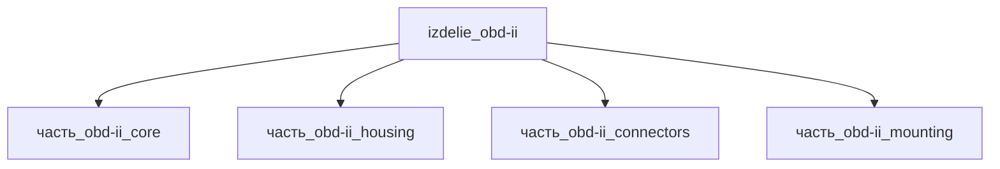

# Изделие: OBD-II

## Описание

OBD-II

Полное наименование (как в CSV): `OBD-II`

## Технические характеристики

| Параметр | Значение | Единица | Источник |
|---|---|---|---|
| подсистема | система_связи | — | classify_subsystem |
| категория | прочее | — | — |
| габариты (bounding box) | 76 × 51 × 45 | мм | под-панельный DLC-кронштейн 75.9×51.1 мм (eBay/Mobilistics) + кожух 38 мм |
| выработка тепла | 1.2 | W | расчёт: ядро 1.0 Вт (класс OBD-II, konnectgps.com/sinocastel.com) + потери DC-DC 0.2 Вт (КПД 0.85) |

Габариты bounding box приняты по компоновке под-панельного диагностического узла OBD-II (SAE J1962): монтажная пластина-кронштейн 70×45×3 мм (mounting, SAE J1962_201607 — канон), кожух ядра 56×30×38 мм (housing), ядро 48×26×33 мм (core), разъём J1962 30.81×12.55×8.6 мм (connectors). Итог: l=76 и w=51 мм — габарит реального под-панельного монтажного кронштейна DLC (2.99×2.01 in = 75.9×51.1 мм); h=45 мм = пластина 3 + кожух 38 + припуск ~4 мм на винты/уплотнитель. Проверка упаковки: V=174 420 мм³ ≥ ΣV(детей)=117 799 × 1.15 (коэффициент 1.48); оси 76≥70, 51≥45, 45≥38. Ручные сканеры-аналоги (Autel AutoLink AL319, 117×72×18 мм, 0.18 кг) — другая форма-фактор: плоский корпус с экраном, не вмещает вертикальный кожух 38 мм.

## Состав

Узел верхнего уровня, 4 части: ядро — диагностический интерфейс (`часть_obd-ii_core`, 0.03 кг), кожух ядра (`часть_obd-ii_housing`, 0.027 кг), комплект разъёмов DE-9 (`часть_obd-ii_connectors`, 0.02 кг), монтажный кронштейн SAE J1962 (`часть_obd-ii_mounting`, 0.016 кг).

## Используемые технологии

(Ссылки на реальные_данные/технологии/ добавляются после связывания)

## Используемые материалы

(Ссылки на реальные_данные/материалы/ добавляются после связывания)

## Принцип работы

Узел под-панельной диагностики OBD-II не генерирует энергию: вся электрическая мощность, потребляемая ядром от бортовой сети 12 В, рассеивается в тепло (КПД вычислений около 0). Тепловой поток: ядро 1.0 Вт (класс активного потребления OBD-II адаптера 150-300 мА при 12 В) + потери DC-DC 12->5 В около 0.2 Вт, суммарный номинал узла 1.2 Вт; пассивные части (кожух, кронштейн, контакты DE-9) собственного тепловыделения не имеют (менее 5 мВт суммарно). Отвод тепла — через кожух AL 6061-T6 (одновременно ЭМИ-экран) и монтажную пластину в панель автомобиля; пиковый режим GPS+GSM 1.8-3.6 Вт кратковременен и покрыт диапазоном max = 3.6 Вт.

## Источники

- Токопотребление OBD-II GPS-трекеров: активный режим 150-300 мА, сон 5-30 мА при бортовых 12 В — https://konnectgps.com/blogs/news/does-an-obd-gps-tracker-drain-your-car-battery (обращение 2026-11-08)
- Структура потребления OBD-трекера: GPS-модуль 20-50 мА, 4G-модуль — https://www.sinocastel.com/battery-capacity-of-an-obd-tracker (обращение 2026-11-08)
- CSV: `начальные данные_final.csv` (пользовательский ввод)

---

## Декомпозиция

