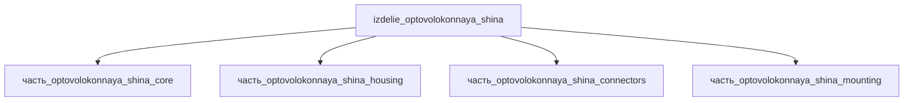

## Описание

оптоволоконная шина

Полное наименование (как в CSV): `оптоволоконная шина`

## Технические характеристики

| Параметр | Значение | Единица | Источник |
|---|---|---|---|
| подсистема | система_связи | — | canon |
| подтип | прочее | — | canon |
| масса | 0.1–5.0 (номинал 0.5) | kg | canon |
| габариты (Д×Ш×В) | 200×117×46 | mm | canon |
| выработка энергии | 0 | W | canon |
| выработка тепла | 0.01–5 | W | canon |
| тип узла | изделие | — | canon |
| уровень_номер | 1 | — | canon |

## Принцип работы

Оптоволоконная шина — канал передачи данных по волоконно-оптическим линиям (авионика: MIL-STD-1773 — волоконная реализация протокола MIL-STD-1553B): терминалы BC/RT/BM обмениваются данными через пассивные волоконные ответвления; активная электроника терминалов (ядро, <=1 W на трансивер) генерирует тепло, пассивные волоконные тракты вносят только вставочные потери (~0.1 W), разъёмы MPO/MTP терминируют линии. Иммунитет к ЭМИ и гальваноразвязка — ключевые преимущества перед медной шиной.

## Состав

Изделие верхнего уровня (4 части): ядро (коммутационный блок 130×85×28), корпус (150×98×33), комплект разъёмов MPO/MTP, крепёж/жгуты (60×25×6). См. раздел Декомпозиция.

## Используемые технологии

- `frezervanie_chpu` (доля: 1.0)
- `anodirovanie` (доля: 1.0)

## Используемые материалы

- `al_6061-t6` (форма: силовые_элементы_конструкций) → [`al_6061-t6`](../../../материалы/al_6061-t6.md)
- `al_6061-t6` (форма: корпуса_электроники) → [`al_6061-t6`](../../../материалы/al_6061-t6.md)

## Источники

- CSV: `начальные данные_final.csv` (пользовательский ввод)
- MIL-STD-1773 Fiber Optic Data Bus, NASA GSFC (Small Explorer Data System, M. Flanegan) — https://core.ac.uk/download/pdf/42812227.pdf (обращение 2026-11-08)
- LINK-PP — 10GBASE-T SFP Power & Heat Management Guide: оптические трансиверы <1 W, медные модули ~3 W — https://www.link-pp.com/resources/technical-specs/10gbase-t-sfp-power-heat-management-guide (обращение 2026-11-08)

---

## Декомпозиция

