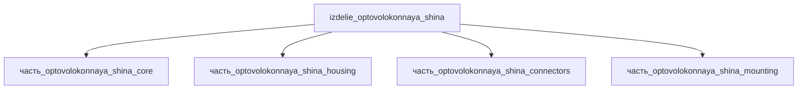

# Изделие: оптоволоконная шина

## Описание

оптоволоконная шина

Полное наименование (как в CSV): `оптоволоконная шина`

## Технические характеристики

| Параметр | Значение | Единица | Источник |
|---|---|---|---|
| подсистема | система_связи | — | classify_subsystem |
| категория | прочее | — | — |
| выработка тепла (nominal) | 1.2 | W | СУММ(детей) 1.10 (core 1 + connectors 0.1) + пассивные потери ~0.1; трансиверы <=1 W — LINK-PP / SFP+ Thermal 2013 |

Тепловой баланс: номинал выработки тепла 1.2 W = СУММ(дочерних) 1.10 W (core 1 W — активные оптические трансиверы; connectors 0.1 W — терминаторы MPO/MTP) + собственные пассивные потери ~0.1 W; диапазон 0.01–5 W покрывает пассивные и многотерминальные конфигурации. См. fc_изделие_масса, fc_изделие_стандарты в _field_contracts.yaml.

## Состав

Изделие верхнего уровня (4 части): ядро (коммутационный блок 130×85×28), корпус (150×98×33), комплект разъёмов MPO/MTP, крепёж/жгуты (60×25×6). См. раздел Декомпозиция.

## Используемые технологии

(Ссылки на реальные_данные/технологии/ добавляются после связывания)

## Используемые материалы

(Ссылки на реальные_данные/материалы/ добавляются после связывания)

## Принцип работы

Оптоволоконная шина — канал передачи данных по волоконно-оптическим линиям (авионика: MIL-STD-1773 — волоконная реализация протокола MIL-STD-1553B): терминалы BC/RT/BM обмениваются данными через пассивные волоконные ответвления; активная электроника терминалов (ядро, <=1 W на трансивер) генерирует тепло, пассивные волоконные тракты вносят только вставочные потери (~0.1 W), разъёмы MPO/MTP терминируют линии. Иммунитет к ЭМИ и гальваноразвязка — ключевые преимущества перед медной шиной.

## Источники

- CSV: `начальные данные_final.csv` (пользовательский ввод)
- MIL-STD-1773 Fiber Optic Data Bus, NASA GSFC (Small Explorer Data System, M. Flanegan) — https://core.ac.uk/download/pdf/42812227.pdf (обращение 2026-11-08)
- LINK-PP — 10GBASE-T SFP Power & Heat Management Guide: оптические трансиверы <1 W, медные модули ~3 W — https://www.link-pp.com/resources/technical-specs/10gbase-t-sfp-power-heat-management-guide (обращение 2026-11-08)

---

## Декомпозиция

