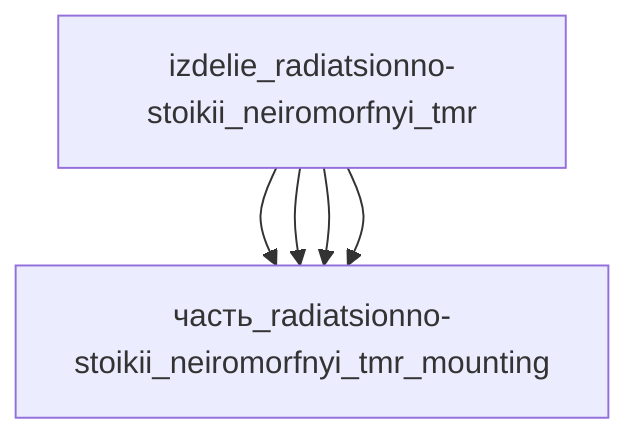

# Изделие: радиационно-стойкий нейроморфный TMR

## Описание

Радиационно-стойкий нейроморфный вычислительный модуль — спайковый нейропроцессор с тройной модульной избыточностью (TMR — triple modular redundancy) для защиты от одиночных событийных эффектов (SEU) космической радиации. Ядро — керамический CCGA-корпус 42×42 мм класса радиационно-стойких чипов (прецедент Xilinx XQR Virtex-5QV CCGA1137 42.5×42.5 мм), размещён в алюминиевой оболочке с Micro-D жгутом и стальной рамкой-экраном MTJ-синапсов.

Полное наименование (как в CSV): `радиационно-стойкий нейроморфный TMR`

## Технические характеристики

| Параметр | Значение | Единица | Источник |
|---|---|---|---|
| подсистема | система_связи | — | classify_subsystem |
| категория | электроника | — | синхронизировано с YAML |
| масса | 0.1 (0.005–5) | kg | номинал изделия (ядро 20 г + корпус 18 г + жгут 80 г + рамка 25 г + плата) |
| габариты (Д×Ш×В) | 50×30×5 | mm | канон изделия |
| выработка тепла | 1.5 (0.01–5) | W | системный тепловой поток — класс Loihi 2 (Intel brief, arXiv 2408.16096) + GR740 LEON4FT (rad-hard класс < 3 Вт) |
| выработка энергии | 0 | W | canon |

## Состав

Изделие верхнего уровня, 4 дочерних части:

- `часть_radiatsionno-stoikii_neiromorfnyi_tmr_core` — радиационно-стойкий нейроморфный вычислитель (TMR, CCGA 42×42×5, 20 г, ~1 Вт — единственный источник тепла)
- `часть_radiatsionno-stoikii_neiromorfnyi_tmr_housing` — алюминиевый корпус-оболочка с ЭМИ-экранированием (49×49×8, 18 г, пассивная)
- `часть_radiatsionno-stoikii_neiromorfnyi_tmr_connectors` — Micro-D жгут 79 контактов (MIL-DTL-83513, 80 г, пассивный)
- `часть_radiatsionno-stoikii_neiromorfnyi_tmr_mounting` — стальная рамка-экран с пружинным контактом (32×32×8, 25 г, пассивная)

## Используемые технологии

(Ссылки на реальные_данные/технологии/ добавляются после связывания)

## Используемые материалы

(Ссылки на реальные_данные/материалы/ добавляются после связывания)

## Принцип работы

Спайковая нейроморфная обработка данных — входной поток кодируется асинхронными спайками, MTJ-синапсы ядра выполняют событийные вычисления с энергопотреблением ~1 Вт (класс Loihi 2). Тройная модульная избыточность (TMR): три идентичных вычислительных канала внутри кристалла работают параллельно, мажоритарный элемент отбрасывает канал, поражённый SEU-ошибкой космической радиации — сбой маскируется без прерывания вычислений. Алюминиевая оболочка экранирует ЭМИ и отводит тепло ядра к плате; стальная рамка прижимает крышку магнитного экрана (поля >10 Э сбивают TMR-состояния синапсов); Micro-D жгут выносит шины троированных каналов, питание и телеметрию.

## Источники

- CSV: `начальные данные_final.csv` (пользовательский ввод)
- Intel Neuromorphic Computing Loihi 2 brief — «Loihi consumes far less than 1 watt of power» (класс мощности нейроморфных процессоров): https://www.intel.com/content/dam/www/central-libraries/us/en/documents/neuromorphic-computing-loihi-2-brief.pdf (проверено 2026-11-08)
- Analyzing Energy Consumption of Loihi 2 (arXiv 2408.16096) — потребление 1.55 Вт при 103.94 GOP/s/W: https://arxiv.org/html/2408.16096v1 (проверено 2026-11-08)
- Frontgrade Gaisler GR740 Quad-core LEON4FT — радиационно-стойкий бортовой процессор, «very low power, < 3 W (core typical)» — класс-прецедент мощности радиационно-стойких вычислителей: https://www.gaisler.com/products/gr740 (проверено 2026-11-08)

---

## Декомпозиция

