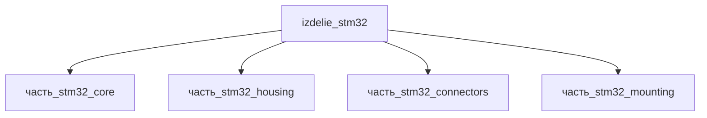

# Изделие: STM32

## Описание

STM32

Полное наименование (как в CSV): `STM32`

## Технические характеристики

| Параметр | Значение | Единица | Источник |
|---|---|---|---|
| подсистема | система_связи | — | classify_subsystem |
| категория | прочее | — | — |
| масса (номинал) | 0.1 | kg | модуль MCU с платой, корпусом и разъёмами (оценка по составу частей) |
| габариты (Д×Ш×В) | 60×40×12 | mm | сборочная огибающая: монтажная плата 55×35×8 + разъёмы + корпус 17×17×4 |
| выработка тепла (номинал) | 1.2 | W | Σ частей (core 1.0 + connectors 0.1 Вт) + собственные утечки |
| материалы | si, aluminum, al_6061-t6, stal_st3, peek | — | материалы_частей + дочерние файлы |

## Состав

Изделие верхнего уровня. Дочерние части (4):

- `часть_stm32_core` — МСУ-кристалл (si, LQFP 14×14×1.6 мм, 0.0012 кг, 1 Вт)
- `часть_stm32_housing` — корпус (al_6061-t6, 17×17×4 мм, 0.015 кг)
- `часть_stm32_connectors` — разъёмы (stal_st3, 39.14×12.55×8.6 мм, 0.03 кг)
- `часть_stm32_mounting` — монтажная плата (peek, 55×35×8 мм, 0.002 кг)

## Используемые технологии

- `ion_implantation_si` — ионная имплантация (легирование) кремниевой подложки CMOS-кристалла (si: «базовая подложка CMOS, памяти, МЭМС», si.md); связь зафиксирована в технологии_частей.
- `frezervanie_chpu` — ЧПУ-фрезерование алюминиевого корпуса (al_6061-t6: «the most common choice for CNC machined enclosures», Davantech); связь зафиксирована в технологии_частей.

## Используемые материалы

- `si` (форма: подложки_ис_и_мэмс) — монокристаллическая подложка МСУ-кристалла (CZ, ориентация (100), топологические нормы 3–90 нм)
- `aluminum` (форма: корпуса_электроники) — корпус-кожух с ЭМИ-экранированием
- `al_6061-t6` — фактический сплав корпуса (дочерний файл)
- `stal_st3` — разъёмы (дочерний файл); `peek` — монтажная плата (дочерний файл)

## Принцип работы

STM32 — семейство 32-битных микроконтроллеров Arm Cortex-M (STM32H743: Cortex-M7 до 480 МГц, 3.6 В, 856 DMIPS, корпуса 100–240 выводов, LQFP100 = 14×14 мм). Кристалл (si-CMOS) монтируется на монтажную плату с обвязкой, накрывается алюминиевым корпусом с ЭМИ-экранированием; разъёмы подводят питание и I/O-контуры периферии. Динамическая мощность CMOS P ≈ C·V²·f растёт с частотой — тепловыделение ядра определяет тепловой баланс модуля.

## Источники

- CSV: `начальные данные_final.csv` (пользовательский ввод)
- STMicroelectronics — STM32H743 datasheet (Cortex-M7 до 480 МГц, LQFP100 14×14 мм, 3.6 В): https://www.st.com/resource/en/datasheet/stm32h743vi.pdf
- Davantech — Aluminum Enclosures (6061-T6 — типовой сплав CNC-корпусов): https://www.davantech.com/aluminum-enclosures

---

## Декомпозиция

