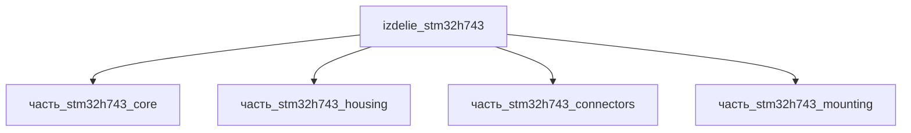

# Изделие: STM32H743

## Описание

STM32H743 — высокопроизводительный микроконтроллер ST: ядро Arm Cortex-M7 @ 480 МГц, 2 МБ Flash, 1 МБ RAM, корпус LQFP144 (20×20×1.6 мм), питание 1.71–3.6 В. Тепловой баланс (DS12381/Emcraft SOM): Run @400–480 МГц с включённой периферией — 160 мА typ / 220 мА max @3.3 В (0.53–0.73 Вт), на полной частоте 480 МГц ~0.9–1.3 Вт; Standby 2.43 мкА. Номинал рассеивания модуля 0.9 Вт (typ full-speed run); максимум 2.0 Вт ограничен TJ=125 °C при Rth(ja)≈30–45 °C/Вт для LQFP144. Практически всё тепло выделяется на кристалле (часть core, 0.8 Вт), выводы/разъёмы добавляют контактные потери (~0.01 Вт), корпус и монтажная пластина пассивны.

Полное наименование (как в CSV): `STM32H743 (Cortex-M7, 480 МГц)`

## Технические характеристики

| Параметр | Значение | Единица | Источник |
|---|---|---|---|
| подсистема | система_связи | — | classify_subsystem |
| категория | прочее | — | — |
| выработка тепла (nominal) | 0.9 | W | DS12381: Run 160 мА typ @400 МГц / ~300 мА @480 МГц @3.3 В |
| выработка тепла (max) | 2.0 | W | предел по TJ=125 °C, Rth(ja)≈30–45 °C/Вт (LQFP144) |
| выработка тепла (min) | 0.01 | W | Standby 2.43 мкА (DS12381) |

## Состав

Изделие верхнего уровня, 4 части (уровень 2): core (кристалл LQFP144, 0.8 Вт), housing (корпус, пассив), connectors (USB Type-C гнездо, 0.01 Вт), mounting (монтажная пластина 50×30×1.5, пассив).

## Используемые технологии

(Ссылки на реальные_данные/технологии/ добавляются после связывания)

## Используемые материалы

(Ссылки на реальные_данные/материалы/ добавляются после связывания)

## Принцип работы

Требует описания на основе инженерного анализа.

## Источники

- CSV: `начальные данные_final.csv` (пользовательский ввод)
- ST DS12381 — STM32H742/743 datasheet: https://www.st.com/resource/en/datasheet/stm32h743vi.pdf (обращение 2026-11-07)
- Emcraft STM32H7 SOM — Theoretically Calculated Max Power Consumption (220 мА max @3.3 В @400 МГц): https://www.emcraft.com/som/stm32h7/STM32H7-SOM-CURRENT_CONSUMPTION.pdf (обращение 2026-11-07)

---

## Декомпозиция

