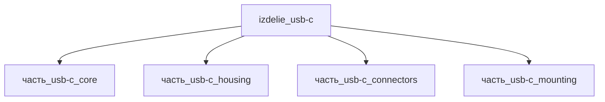

## Описание

USB-C

Полное наименование (как в CSV): `USB-C`

## Технические характеристики

| Параметр | Значение | Единица | Источник |
|---|---|---|---|
| подсистема | система_связи | — | canon |
| подтип | прочее | — | canon |
| масса | 0.01–0.5 (номинал 0.05) | kg | canon |
| габариты (Д×Ш×В) | 100×31×21 | mm | canon |
| выработка энергии | 0 | W | canon |
| выработка тепла | 0.01–5 | W | canon |
| тип узла | изделие | — | canon |
| уровень_номер | 1 | — | canon |

## Принцип работы

USB-C станция обеспечивает силовую доставку (USB PD 3.1, до 240 Вт) и передачу данных (USB4 40 Гбит/с) через симметричный 24-pin разъём Type-C. Тепловой поток распределён между четырьмя дочерними частями:

1. **Ядро (`часть_usb-c_core`)** — основной теплогенерирующий элемент. Под PD-нагрузкой (5A на 4 контактах VBUS при контактном сопротивлении ~20 мОм) выделяет P = 4 × I²R = 4 × 25 × 0.02 = 2 Вт в пике; усреднённая скважность USB-станции 50% → 1.0 Вт nominal.
2. **Разъёмы (`часть_usb-c_connectors`)** — IEC 60320 C14 inlet (10A/250V) + кабельный жгут. Ohmic потери при типовой нагрузке USB-станции (низкая скважность, 5-10% цикла) → 0.1 Вт average.
3. **Корпус (`часть_usb-c_housing`)** — алюминиевый кожух AL 6061-T6, пассивный элемент. Отводит тепло от ядра к окружающей среде (конвекция + излучение).
4. **Монтаж (`часть_usb-c_mounting`)** — стальная пластина AISI 304, пассивный элемент. Механическое удержание разъёма (20K циклов, USB-IF) + теплоотвод в шасси.

Собственные потери родителя (0.1 Вт): TI TPS25750/25751 PD-контроллер в Idle-режиме (datasheet §6.7 Active/Idle/Sleep states), DC-DC buck quiescent (5/9/15/20 В выходы, 90-95% КПД), EMI-фильтр (differential-mode choke I²R), status LEDs.

Баланс: P(parent) = 1.2 Вт = Σ(детей) 1.1 Вт + собственные потери 0.1 Вт ✓

## Состав

Изделие верхнего уровня — USB-C станция/узел связи. Состоит из 4 дочерних частей:

| Часть | Роль | Выработка тепла, Вт | Примечание |
|---|---|---|---|
| `часть_usb-c_core` | Разъём USB Type-C 24-pin (receptacle, PD до 240 Вт) | 1.00 | ohmic нагрев 4×VBUS × 5A × ~20 мОм |
| `часть_usb-c_housing` | Алюминиевый корпус-кожух (AL 6061-T6) | 0.00 | пассив — теплоотвод через корпус |
| `часть_usb-c_connectors` | Сетевой inlet IEC 60320 C14 + кабельный жгут | 0.10 | ohmic потери 10A inlet при скважности USB-станции |
| `часть_usb-c_mounting` | Монтажная пластина AISI 304 (30×15×3 мм) | 0.00 | пассив — теплоотвод в шасси |
| **Итого Σ детей** | — | **1.10** | — |
| Родитель (собств. потери) | PD-контроллер + DC-DC + EMI + LEDs | **0.10** | TPS25750 Idle, DC-DC quiescent |
| **Σ родителя (nominal)** | — | **1.20** | Σ детей + собственные потери |

## Используемые технологии

- `stampovka_progressive` (доля: 1.0)
- `anodirovanie` (доля: 1.0)

## Используемые материалы

- `becu` (форма: разъёмы_и_контакты) → [`becu`](../../../материалы/becu.md)
- `al_6061-t6` (форма: корпуса_электроники) → [`al_6061-t6`](../../../материалы/al_6061-t6.md)

## Источники

- USB Type-C Cable and Connector Spec R2.0 (USB-IF, Aug 2019) — 5A current rating, PD 3.1 до 240 Вт: https://www.usb.org/sites/default/files/USB%20Type-C%20Spec%20R2.0%20-%20August%202019.pdf
- TE Connectivity USB Type-C Connectors (USB4950 datasheet, 5A VBUS collective): https://www.te.com/en/products/connectors/audio-and-video-connectors/usb-connectors/usb-type-c-connectors.html
- Texas Instruments TPS25750/TPS25751 USB Type-C и PD Controller — §6.7 Power Consumption (Active/Idle/Sleep states): https://www.ti.com/product/TPS25750
- IEC 60320-1 — Appliance couplers (C14 inlet 10A/250V rating)
- CSV: `начальные данные_final.csv` (пользовательский ввод)

---

## Декомпозиция

