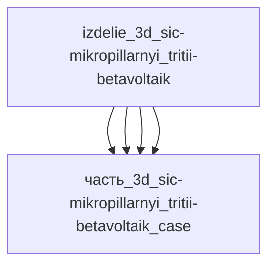

# Изделие: 3D SiC-микропилларный тритий-бетавольтаик

## Описание

3D SiC-микропилларный тритий-бетавольтаик

Полное наименование (как в CSV): `3D SiC-микропилларный тритий-бетавольтаик`

## Технические характеристики

| Параметр | Значение | Единица | Источник |
|---|---|---|---|
| подсистема | энергетическая | — | classify_subsystem |
| категория | прочее | — | — |
| тепловыделение (β-распад трития) | 0.162 Вт (min 0.081 после 1 T½) | Вт | Pillinger 1961, Phys. Rev. 121, 232: 0.3240±0.0009 Вт/г × 0.5 г |

(Параметры требуют уточнения через веб-поиск и вычислений; см. fc_изделие_масса, fc_изделие_стандарты в _field_contracts.yaml)

## Состав

Изделие верхнего уровня. Дочерние части: isotope (ScT₂ слой), micropillars (4H-SiC), substrate (4H-SiC), case (Ti-6Al-4V капсула).

## Используемые технологии

(Ссылки на реальные_данные/технологии/ добавляются после связывания)

## Используемые материалы

(Ссылки на реальные_данные/материалы/ добавляются после связывания)

## Принцип работы

Требует описания на основе инженерного анализа.

## Источники

- CSV: `начальные данные_final.csv` (пользовательский ввод)
- Pillinger, W. L. et al. — «Calorimetric Determination of the Heat Output of Tritium», Physical Review 121, 232 (1961): 0.3240±0.0009 Вт/г — https://link.aps.org/doi/10.1103/PhysRev.121.232 (обращение 2026-11-08)
- OSTI 4120857 (Pillinger, калориметрия трития 0.3240 Вт/г) — https://www.osti.gov/biblio/4120857
- Wikipedia Tritium (удельная активность 9650 Ки/г = 3.57×10¹⁴ Бк/г) — https://en.wikipedia.org/wiki/Tritium

---

## Декомпозиция

