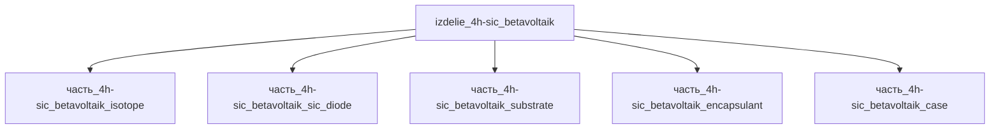

# Изделие: 4H-SiC бетавольтаик

## Описание

Бетавольтаический источник питания на широкозонном 4H-SiC: радиоизотопный преобразователь β-распада Ni-63 (T½ = 100.1 лет, Eβ,max = 66.7 кэВ) в электричество через p-i-n/p-n структуру 4H-SiC. Исследовательский класс: демонстрация Qiao et al. 2008 (Chinese Physics Letters, КПД 1.2 %), современные меш-структурированные ячейки дают +65.1 % к мощности против планарных (расчётная Pmax ~2.55 мкВт/см² при 17 кэВ). Габариты 20×20×2 мм (пластина-класс), масса 5–50 г (номинал 10 г), электрическая мощность 10 мкВт–1 мВт (номинал 100 мкВт). Единственный источник тепла — распад Ni-63: удельная тепловая мощность 5.8 мВт/г, тепловыделение изделия 2.9–5.8 мВт (BOL–EOL через 100 лет).

Полное наименование (как в CSV): `4H-SiC бетавольтаик`

## Технические характеристики

| Параметр | Значение | Единица | Источник |
|---|---|---|---|
| подсистема | энергетическая | — | classify_subsystem |
| категория | прочее | — | — |
| масса | 0.005–0.05 (номинал 0.01) | kg | canon |
| габариты (Д×Ш×В) | 20×20×2 | mm | canon (пластина-класс) |
| выработка энергии | 1e-05–0.001 (номинал 0.0001) | W | canon |
| выработка тепла | 0.0029–0.0058 (номинал 0.0058) | W | расчёт: 1 г Ni-63 × 5.8 мВт/г (A=2.1 ТБк/г × E̅β≈17.4 кэВ); EOL 100 лет (1 T½) → 2.9 мВт |
| КПД | 1.2 | % | Qiao 2008 (CPL), демонстрация 4H-SiC betavoltaic |

## Состав

Изделие верхнего уровня, 5 дочерних частей уровня 2:

- `часть_4h-sic_betavoltaik_isotope` — источник Ni-63 (6×6×0.15 мм, 1 г); единственный генератор тепла (5.8 мВт BOL);
- `часть_4h-sic_betavoltaik_sic_diode` — меш-структурированная p-i-n ячейка 4H-SiC (0.9×0.9 мм);
- `часть_4h-sic_betavoltaik_substrate` — подложка 4H-SiC 20×20×0.5 мм;
- `часть_4h-sic_betavoltaik_encapsulant` — защитная инкапсуляция;
- `часть_4h-sic_betavoltaik_case` — корпус.

## Используемые технологии

(Ссылки на реальные_данные/технологии/ добавляются после связывания)

## Используемые материалы

Материалы частей: ni-63 (изотоп), monokristallicheskogo_sic / 4H-SiC (диод, подложка) — см. `реальные данные/материалы/`.

## Принцип работы

Ядра Ni-63 испытывают β⁻-распад до стабильного Cu-63, испуская электроны с Eβ,max = 66.7 кэВ (средняя ≈17.4 кэВ); при удельной активности чистого Ni-63 2.1 ТБк/г (λ·N_A/M для T½=100.1 лет; Yakimov 2023: 525 Ки/см³) каждый грамм изотопа выделяет 5.8 мВт тепла. β-электроны через защитный слой попадают в обеднённую область 4H-SiC p-n/p-i-n перехода, где создают тысячи электрон-дырочных пар; поле перехода разделяет заряды — постоянный ток наноамперного уровня на протяжении ~100-летнего периода полураспада. Демонстрационный прототип Qiao et al. (CPL 2008) показал КПД преобразования 1.2 % (ограничение — низкое шунтовое сопротивление, обратное рассеяние и поглощение электронов); меш-структурирование активной поверхности (+65.1 % мощности при 5 кэВ против планарной ячейки, PMC 2025) поднимает расчётную Pmax до ~2.55 мкВт/см² — КПД изделия 100 мкВт/5.8 мВт ≈ 1.7 % лежит в реальном диапазоне 1.2–4.3 %. Не преобразованная в электричество мощность распада рассеивается теплом: изотоп → подложка/диод → encapsulant → case → окружающая среда; активность и тепловыделение спадают по закону 2^(−t/T½) — через 100 лет (1 T½) тепловыделение снижается до 2.9 мВт.

## Источники

- CSV: `начальные данные_final.csv` (пользовательский ввод)
- Qiao D.Y. et al., «Demonstration of a 4H SiC Betavoltaic Nuclear Battery» (КПД 1.2 %), Chinese Physics Letters: https://cpl.iphy.ac.cn/en/article/pdf/preview/42654.pdf
- Меш-структурированная 4H-SiC p-i-n ячейка (+65.1 %, Pmax ~2.55 мкВт/см²): https://pmc.ncbi.nlm.nih.gov/articles/PMC13066639
- IAEA INIS, «Nickel-63 standardization: 1968–1995» (T½ = 101.1±1.4 г, Eβ,max = 66.945 кэВ): https://inis.iaea.org/records/6bqyx-kza10
- Yakimov E.B. et al., «Prediction of Betavoltaic Battery Parameters» (2023) — удельная активность чистого Ni-63 525 Ки/см³
- OSTI/DOE, Ni-63 на текстурированном 4H-SiC (КПД ×2 против Si): https://science.osti.gov/Isotope-Research-Development-and-Production/Science-Highlights/2021/IP-2021-12-a

---

## Декомпозиция

