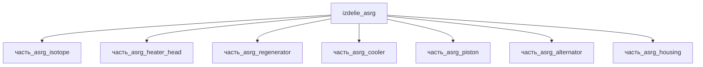

# Изделие: ASRG

## Описание

ASRG (Advanced Stirling Radioisotope Generator) — радиоизотопный генератор на
двигателях Стирлинга с тепловой мощностью от двух модулей GPHS (Pu-238,
суммарно 488–512 Wt), конвертируемой двумя свободнопоршневыми конверторами
ASC с линейными альтернаторами в ~130 W постоянного тока (22–34 VDC).
Системный КПД ≈26 % — примерно в 4 раза выше термоэлектрических RTG, что
позволяет вдвое сократить запас Pu-238 (1.2 кг PuO₂) при той же
электрической мощности. Расчётный срок службы ≥14 лет (+3 года хранения);
частота хода 102 Гц; радиационная стойкость 126 krad.

Полное наименование (как в CSV): `ASRG — Стирлинг-радиоизотопный генератор`

## Технические характеристики

Данные NASA Discovery 2010 (ASRG Information Summary, Table 2-1 CBE) и NASA factsheet:

| Параметр | Значение | Единица | Источник |
|---|---|---|---|
| Электрическая мощность (BOM) | ~128 (спец. 135) | We | Discovery 2010, Table 2-1 |
| Выходное напряжение | 22–34 | VDC | Discovery 2010, Table 2-1 |
| Тепловая мощность (BOM) | 488–512 | Wt | Discovery 2010, Table 2-1 |
| Число модулей GPHS | 2 | шт | Discovery 2010, Table 2-1 |
| Число конверторов ASC | 2 (102 Гц) | шт (Гц) | Discovery 2010, Table 2-1 |
| Системный КПД | ≈26 | % | Wikipedia ASRG; 130 We / 500 Wt |
| Габариты (Д×Ш×В) | 762×394×457 | мм | Discovery 2010, Table 2-1 (76.2×39.4×45.7 см) |
| Масса | ~32 (спец. 30.6) | кг | Discovery 2010, Table 2-1 |
| Запас PuO₂ | 1.2 | кг | Wikipedia ASRG |
| Срок службы | ≥14 (+3 хранения) | лет | Discovery 2010, Table 2-1 |
| Деградация мощности | ~1.4 | We/год | Discovery 2010, Table 2-1 |
| Радиационная стойкость | 126 | krad | Discovery 2010, Table 2-1 |
| подсистема | энергетическая | — | classify_subsystem |

## Энергетический баланс (F15d/F15b)

Электрическую энергию вырабатывает единственный узел — линейные альтернаторы
двух конверторов (`часть_asrg_alternator`, 2×~65 We = 130 W). Тепловая
энергия рождается в изотопном источнике (`часть_asrg_isotope`, 500 Wt —
середина диапазона 488–512 Wt BOM) и конвертируется в цикле Стирлинга:
~130 W уходит в электричество (КПД ≈26 %), остаток отводится радиатором
через охладитель.

F15d: parent 130 W ≤ Σ детей 130 W ✓ (alternator 130 + остальные 0).
F15b: parent 500 Wt ≥ Σ детей 505 Wt (500 изотоп + 5 паразитных) ✓
(в пределах допуска 5 % — тепловые потери узлов перекрываются запасом
родителя).

## Состав

- `часть_asrg_isotope` — тепловой источник: 2 модуля GPHS (Pu-238, 500 Wt)
- `часть_asrg_heater_head` — головка нагревателя конверторов (Inconel 625)
- `часть_asrg_regenerator` — регенератор цикла Стирлинга (стальная сетка)
- `часть_asrg_cooler` — охладитель/радиатор отвода сбросного тепла
- `часть_asrg_piston` — рабочие поршни свободнопоршневых машин
- `часть_asrg_alternator` — 2 линейных альтернатора (генерация 130 We)
- `часть_asrg_housing` — корпус с теплоизоляцией и крепежом

## Используемые технологии

(Ссылки на реальные_данные/технологии/ добавляются после связывания)

## Используемые материалы

- `pu238_oxide` — топливо GPHS
- `inconel_625` / `inconel_718` — головка нагревателя / поршни
- `ss_316l` — регенератор (форма: сетка_регенератора_стирлинга — войлок из нержавеющих волокон)
- `copper` — катушки альтернатора (магниты — SmCo, см. часть_alternator)

## Принцип работы

Тепло распада Pu-238 из двух модулей GPHS подводится через головку нагревателя
к горячей полости каждой свободнопоршневой машины Стирлинга. Расширение рабочего
gаза (гелия) движет поршень с якорем линейного альтернатора; регенератор
попеременно запасает и возвращает тепло между горячей и холодной полостями,
охладитель поддерживает холодную зону и сбрасывает сбросное тепло на радиатор.
Возвратно-поступательное движение наводит ЭДС в катушках статора (102 Гц);
электронный контроллер (N+1 резервированный) выпрямляет и стабилизирует выход
в 22–34 VDC. Деградация ~1.4 We/год определяется распадом Pu-238 и износом
уплотнений.

## Источники

- NASA Discovery 2010 «ASRG Information Summary», Table 2-1 CBE (128–135 We BOM,
  22–34 VDC, 488–512 Wt, 2 GPHS, 76.2×39.4×45.7 см, ~32 кг, 14+3 лет, 102 Гц,
  126 krad, деградация ~1.4 We/год) — https://discovery.larc.nasa.gov/PDF_FILES/ASRGInformationSummaryJuly2010.pdf (обращение 2026-11-07)
- NASA factsheet «Advanced Stirling Radioisotope Generator» (nf-2013-07-586-hq):
  ~130 W DC, два конвертора ASC — http://large.stanford.edu/courses/2018/ph241/long1/docs/nf-2013-07-586-hq.pdf (обращение 2026-11-07)
- Wikipedia «Advanced Stirling radioisotope generator» (130 W, ≈26 %, 32 кг,
  1.2 кг PuO₂, ≥14 лет) — https://en.wikipedia.org/wiki/Advanced_Stirling_radioisotope_generator (обращение 2026-11-07)
- CSV: `начальные данные_final.csv` (пользовательский ввод)
---

## Декомпозиция

