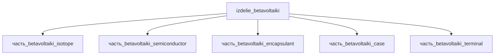

# Изделие: Бетавольтаики

## Описание

Бетавольтаический источник питания (ядерная батарея) верхнего уровня подсистемы энергетическая: радиоизотопный преобразователь β-распада Ni-63 (T½ = 100.1 лет, Eβ,max = 66.7 кэВ) в электричество через p-i-n структуру на монокристаллическом 4H-SiC. Форм-фактор класса City Labs NanoTritium P100: DIP-корпус, выходные напряжения 0.8–2.4 В, токи наноамперного диапазона, ресурс 20+ лет (с Ni-63 — до 50 лет). Масса 10–100 г (номинал 50 г), электрическая мощность 10 мкВт–1 мВт (номинал 100 мкВт). Единственный источник тепла — распад Ni-63: удельная тепловая мощность 5.8 мВт/г, тепловыделение изделия 4.1–5.8 мВт (BOL–EOL).

Полное наименование (как в CSV): `Бетавольтаики`

## Технические характеристики

| Параметр | Значение | Единица | Источник |
|---|---|---|---|
| подсистема | энергетическая | — | classify_subsystem |
| категория | прочее | — | — |
| масса | 0.01–0.1 (номинал 0.05) | kg | canon |
| габариты (Д×Ш×В) | 36.83×15.24×8 | mm | CERDIP-28 600 mil (City Labs NanoTritium P200 = 28-pin CERDIP; Microchip packaging spec 00049w; verify #2143) |
| выработка энергии | 1e-05–0.001 (номинал 0.0001) | W | canon |
| выработка тепла | 0.0041–0.0058 (номинал 0.0058) | W | расчёт: 1 г Ni-63 × 5.8 мВт/г (A=2.1 ТБк/г × E̅β≈17.4 кэВ); EOL 50 лет → 4.1 мВт |

## Состав

Изделие верхнего уровня, 5 дочерних частей уровня 2:

- `часть_betavoltaiki_isotope` — тонкоплёночный источник Ni-63 (10×10×0.2 мм, 1 г); единственный генератор тепла (5.8 мВт BOL);
- `часть_betavoltaiki_semiconductor` — p-i-n преобразователь на 4H-SiC (10×10×0.35 мм);
- `часть_betavoltaiki_encapsulant` — эпоксидная заливка Epon 828/TETA;
- `часть_betavoltaiki_case` — герметичный титановый корпус (35×14×4.5 мм, Ti-6Al-4V);
- `часть_betavoltaiki_terminal` — выводы BeCu C17200 (DIP 2.54 мм).

## Используемые технологии

(Ссылки на реальные_данные/технологии/ добавляются после связывания)

## Используемые материалы

Материалы частей: ni-63 (изотоп), monokristallicheskogo_sic / 4H-SiC (преобразователь), epoksid_epon_828_teta (заливка), ti-6al-4v (корпус), becu (выводы) — см. `реальные данные/материалы/`.

## Принцип работы

Ядра Ni-63 испытывают β⁻-распад до стабильного Cu-63, испуская электроны с Eβ,max = 66.7 кэВ (средняя ≈17.4 кэВ); при удельной активности чистого Ni-63 2.1 ТБк/г (λ·N_A/M для T½=100.1 лет; Yakimov 2023: 525 Ки/см³) каждый грамм изотопа выделяет 5.8 мВт тепла. β-частицы тонкоплёночного источника (толщина плёнки оптимизирована по самопоглощению, arXiv:1903.09098) поглощаются в обеднённой области 4H-SiC p-i-n диода и создают электронно-дырочные пары — «ядерный солнечный элемент»; встроенный потенциал перехода разделяет заряды, секции соединяются последовательно для выходных напряжений 0.8–2.4 В. КПД преобразования ≈1.7 % (100 мкВт электрических из 5.8 мВт распада) — в реальном диапазоне бетавольтаиков 0.5–4.3 % (Guo: теоретический максимум 4.15–4.28 % для идеальной поверхности). Не преобразованная в электричество мощность распада рассеивается теплом: изотоп → encapsulant → case → окружающая среда; активность и тепловыделение спадают по закону 2^(−t/T½) — через 50 лет тепловыделение снижается до 4.1 мВт.

## Источники

- CSV: `начальные данные_final.csv` (пользовательский ввод)
- Модель источника Ni-63 для бетавольтаиков (оптимизация толщины по самопоглощению): https://arxiv.org/html/1903.09098v2
- IAEA INIS, «Nickel-63 standardization: 1968–1995» (T½ = 101.1±1.4 г, Eβ,max = 66.945 кэВ): https://inis.iaea.org/records/6bqyx-kza10
- OSTI/DOE, Ni-63 на текстурированном 4H-SiC (КПД ×2 против Si): https://science.osti.gov/Isotope-Research-Development-and-Production/Science-Highlights/2021/IP-2021-12-a
- Yakimov E.B. et al., «Prediction of Betavoltaic Battery Parameters» (2023) — удельная активность чистого Ni-63 525 Ки/см³
- City Labs, NanoTritium™ P100 series (DIP, 0.8–2.4 В, 50–350 нА): https://citylabs.net/products

---

## Декомпозиция

