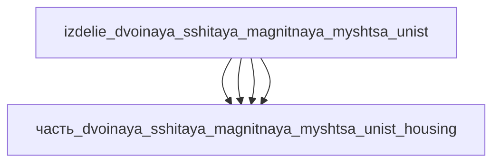

# Изделие: двойная сшитая магнитная мышца UNIST

## Описание

двойная сшитая магнитная мышца UNIST

Полное наименование (как в CSV): `двойная сшитая магнитная мышца UNIST`

## Технические характеристики

| Параметр | Значение | Единица | Источник |
|---|---|---|---|
| подсистема | энергетическая | — | classify_subsystem |
| категория | прочее | — | — |
| сила | 100 | Н | canon (дополнительные) |
| ход | 30 | мм | canon (дополнительные) |
| выработка тепла (режим переключения) | 1.0 | W | Joule-нагрев катушки «до ~1 Вт», AFM 2025 (DOI 10.1002/adfm.202516218); min 0.01 — простой без тока, max 1.0 — пиковое переключение |

(Параметры требуют уточнения через веб-поиск и вычислений; см. fc_изделие_масса, fc_изделие_стандарты в _field_contracts.yaml)

## Состав

Изделие верхнего уровня (уровень 1). Дочерние части:

- `часть_dvoinaya_sshitaya_magnitnaya_myshtsa_unist_magnets` — магнитоактивный композитный слой (NdFeB/полимер с двойной сшивкой), доля массы 0.475;
- `часть_dvoinaya_sshitaya_magnitnaya_myshtsa_unist_coil` — катушка Joule-подогрева (эмалированная медь), доля массы 0.18;
- `часть_dvoinaya_sshitaya_magnitnaya_myshtsa_unist_spring` — возвратная пружина (spring_steel), доля массы 0.19;
- `часть_dvoinaya_sshitaya_magnitnaya_myshtsa_unist_housing` — корпус (неделимый).

Тепловой баланс: Σ(выработка_тепла детей) = 1.0 Вт (только катушка — единственный источник тепла; магнитный слой, пружина и корпус пассивны) ≤ выработка_тепла родителя 1.0 Вт.

## Используемые технологии

(Ссылки на реальные_данные/технологии/ добавляются после связывания)

## Используемые материалы

(Ссылки на реальные_данные/материалы/ добавляются после связывания)

## Принцип работы

Мышца — магнитоактивный композитный привод (NdFeB микрочастицы в матрице полимера с памятью формы с двойной сшивкой, UNIST, DOI 10.1002/adfm.202516218). Внешнее магнитное поле создаёт тягу в магнитном слое — сокращение до 86.4% длины, плотность работы 1150 кДж/м³. Переключение мягкий↔жёсткий — термическое: катушка рассеивает Joule-тепло (~1 Вт, I²R), нагревая композит до температуры разрыва обратимых физических связей двойной сети — мышца переходит в мягкое состояние (растяжение до 12×); при отключении тока связи восстанавливаются — мышца жёстко держит нагрузку до 5 кг. Пружина возвращает ход, корпус защищает композит.

## Источники

- S. Kim et al., «Soft Magnetic Artificial Muscles with High Work Density and Actuation Strain via Dual Cross-Linking Design», Advanced Functional Materials (Wiley), DOI: https://doi.org/10.1002/adfm.202516218 (онлайн 2025-09-07) — сокращение 86.4%, плотность работы 1150 кДж/м³, NdFeB в матрице SMP, переключение тепловым стимулом (разрыв/восстановление физических связей), дата обращения 2026-11-08
- Chosun Biz, «UNIST develops artificial muscle 30 times stronger than human muscle» (2025-09-17): https://biz.chosun.com/en/en-science/2025/09/17/S4PZHTK7JZFHRBJR2T2GKNJFN4 — масса мышцы 1.25 г, нагрузка 5 кг, растяжение до 12×, проф. Hoon Eui Jeong (UNIST Dept. of Mechanical Engineering), дата обращения 2026-11-08
- TechXplore, «Artificial muscle can switch from soft to rigid to support over 4,000 times its own weight» (2025-10-13): https://techxplore.com/news/2025-10-artificial-muscle-soft-rigid-weight.html — механик переключения мягкий/жёсткий, дата обращения 2026-11-08
- CSV: `начальные данные_final.csv` (пользовательский ввод)

---

## Декомпозиция

