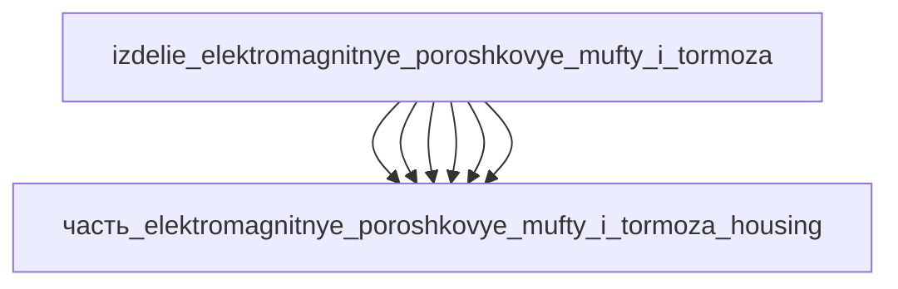

# Изделие: электромагнитные порошковые муфты и тормоза

## Описание

электромагнитные порошковые муфты и тормоза (magnetic particle brake/clutch) — промышленный узел передачи/регулирования момента через магнитопорошковый слой: номинальный момент 50 Нм (24 В, 2 А), DIN VDE 0580. Референсное исполнение — FL50K: наружный диаметр 220 мм, полная длина 150 мм, вал Ø30 мм со шпонкой B8, фланец Ø110 мм M6; корпус цилиндрический с катушкой статора и порошковой полостью. Масса номинал 5 кг (0.5–50 кг диапазон класса).

Полное наименование (как в CSV): `электромагнитные порошковые муфты и тормоза (magnetic particle brake/clutch)`

## Технические характеристики

| Параметр | Значение | Единица | Источник |
|---|---|---|---|
| подсистема | энергетическая | — | classify_subsystem |
| категория | прочее | — | — |
| номинальный момент | 50 | N·m | FL50K magnetic particle clutch datasheet (50 Nm, 24 V / 2 A); Kendrion/Mayr класс |
| масса (ном.) | 5 | kg | класс 0.5–50 кг (DIN VDE 0580), муфта 50 Нм |
| габариты (Д×Ш×В) | 150×220×220 | mm | FL50K datasheet: D0 = 220 мм (наружный Ø), L0 = 150 мм (полная длина), вал Ø30/B8 |

(Масса/момент/габариты — реальные данные FL50K; остальные параметры — диапазоны класса по _field_contracts.yaml)

## Состав

Изделие верхнего уровня (уровень 1), 6 частей уровня 2: coil (катушка возбуждения, copper, 0.8 кг), rotor (ротор с валом Ø30, steel_1045, 1.5 кг), stator (статорное кольцо с магнитопроводом, steel_1045, 1.5 кг), powder (магнитопорошковая смесь в рабочем зазоре, iron_powder, 0.3 кг), bearings (подшипниковые опоры вала, stainless_steel_440c, 0.3 кг), housing (корпус с фланцем Ø110 M6 и кабельным вводом, stal_st3, 5 кг оценка).

## Используемые технологии

(Ссылки на реальные_данные/технологии/ добавляются после связывания)

## Используемые материалы

(Ссылки на реальные_данные/материалы/ добавляются после связывания)

## Принцип работы

Магнитопорошковая передача момента: катушка возбуждения создаёт магнитный поток через рабочий зазор, заполненный ферромагнитным порошком (iron powder); в обесточенном состоянии порошок свободен и муфта проскальзывает, при подаче тока частицы выстраиваются по силовым линиям и связывают ротор со статором — момент регулируется плавно пропорционально току катушки (24 В / 2 А → 50 Нм). Применение: натяжение/торможение в перемоточных машинах, плавный пуск, защита от перегрузки; рассеиваемое тепло 10 Вт номинал (1–100 Вт диапазон) отводится корпусом.

## Источники

- FL50K Magnetic Particle Clutch — datasheet (50 Nm, 24 V / 2 A, D0 = 220, L0 = 150, вал Ø30/B8, фланец Ø110 M6): https://www.scribd.com/doc/317064781/Clutch-Fl50k-Powder-Magnetic-Particle (проверено 2026-11-08)
- Kendrion — Clutches and Brakes (электромагнитные муфты/тормоза, DIN VDE 0580): https://www.kendrion.com/en/products/clutches-and-brakes (проверено 2026-11-08)
- CSV: `начальные данные_final.csv` (пользовательский ввод)

---

## Декомпозиция

