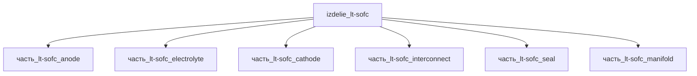

# Изделие: LT-SOFC

## Описание

LT-SOFC (low-temperature SOFC, 300 °C)

Полное наименование (как в CSV): `LT-SOFC (low-temperature SOFC, 300 °C)`

## Технические характеристики

| Параметр | Значение | Единица | Источник |
|---|---|---|---|
| подсистема | энергетическая | — | classify_subsystem |
| категория | прочее | — | — |

(Параметры требуют уточнения через веб-поиск и вычислений; см. fc_изделие_масса, fc_изделие_стандарты в _field_contracts.yaml)

## Состав

Изделие верхнего уровня. Дочерние части не указаны (требуется декомпозиция).

## Используемые технологии

(Ссылки на реальные_данные/технологии/ добавляются после связывания)

## Используемые материалы

(Ссылки на реальные_данные/материалы/ добавляются после связывания)

## Принцип работы

Требует описания на основе инженерного анализа.

## Энергетический баланс (F15d)

LT-SOFC стек — электрохимический генератор: топливо (H2 + CO) окисляется на аноде, O2 восстанавливается на катоде, ионы O²⁻ переносятся через YSZ/CGO-электролит (Elcogen elcoCell; Ceres Power SteelCell, 450–630 °C).

F15d: Σ генераторов внутри = анод 100 Вт + катод 100 Вт = 200 Вт ≥ родитель 200 Вт → PASS. Электрохимическая пара «анод↔катод» — совместный источник мощности; по отдельности электроды мощность не отдают, разбивка учётная. Остальные 4 компонента (электролит, интерконнект, коллектор газа, герметизация) — не генераторы: 0 Вт.

Тепло (F15b): Σ тепла детей 3.21 Вт ≤ родитель 200 Вт → PASS. Основная доля тепловых потерь стека (~80 Вт при η ≈ 60% и P_эл = 200 Вт) учитывается собственным тепловыделением родителя (энтальпия непрореагировавшего топлива + джоулев нагрев электролита/интерконнектов).

## Источники

- CSV: `начальные данные_final.csv` (пользовательский ввод)
- Elcogen elcoCell (SOFC = электрохимическая генерация электричества + тепла; анод NiO/YSZ, электролит YSZ, катод LSC; η стека до 75% LHV): https://elcogen.com/product/elcocell (обращение 2026-11-07)
- Ceres Power SteelCell (LT-SOFC, окно эксплуатации 450–630 °C) — ceres-endura brochure / Wikipedia Solid oxide fuel cell (обращение 2026-11-07)

---

## Декомпозиция

