## Описание

Marx generator

Полное наименование (как в CSV): `Marx generator`

## Технические характеристики

| Параметр | Значение | Единица | Источник |
|---|---|---|---|
| подсистема | энергетическая | — | canon |
| подтип | импульсный_генератор_Маркса | — | canon |
| масса | 50–5000 (номинал 500) | kg | canon |
| габариты (Д×Ш×В) | 1000×800×1650 | mm | canon |
| выработка энергии | 0 | W | canon |
| выработка тепла | 10–1000 | W | canon |
| тип узла | изделие | — | canon |
| уровень_номер | 1 | — | canon |

## Принцип работы

Требует описания на основе инженерного анализа.

## Состав

Изделие верхнего уровня. Дочерние части не указаны (требуется декомпозиция).

## Используемые материалы

- `batio3` (форма: HV_керамика_N4700_класс_I) → [`batio3`](../../../материалы/batio3.md)
- `tungsten` (форма: электроды_искровых_промежутков) → [`tungsten`](../../../материалы/tungsten.md)
- `aluminum` → [`aluminum`](../../../материалы/aluminum.md)

## Источники

- CSV: `начальные данные_final.csv` (пользовательский ввод)

---

## Декомпозиция

```mermaid
graph TD
    izdelie_marx_generator["izdelie_marx_generator"]
    ______marx_generator_capacitors["часть_marx_generator_capacitors"]
    izdelie_marx_generator --> ______marx_generator_capacitors
    ______marx_generator_spark_gaps["часть_marx_generator_spark_gaps"]
    izdelie_marx_generator --> ______marx_generator_spark_gaps
    ______marx_generator_resistors["часть_marx_generator_resistors"]
    izdelie_marx_generator --> ______marx_generator_resistors
    ______marx_generator_housing["часть_marx_generator_housing"]
    izdelie_marx_generator --> ______marx_generator_housing
    ______marx_generator_output_terminal["часть_marx_generator_output_terminal"]
    izdelie_marx_generator --> ______marx_generator_output_terminal
    ______marx_generator_insulator["часть_marx_generator_insulator"]
    izdelie_marx_generator --> ______marx_generator_insulator
```

