# Изделие: Микрореактор деления

## Описание

Микрореактор деления eVinci-класса (5 МВт э / 15 МВт т, HALEU TRISO + натриевые тепловые трубы)

Полное наименование (как в CSV): `Микрореактор деления (Kilopower / KRUSTY)`

## Технические характеристики

| Параметр | Значение | Единица | Источник |
|---|---|---|---|
| подсистема | энергетическая | — | classify_subsystem |
| выработка энергии | 5000000 | W | eVinci — 5 MWe microreactor (NRC ML23053A351; IAEA ARIS eVinci, 2024) |
| выработка тепла | 15000000 | W | eVinci — 15 MWt core, 19.75 % HALEU TRISO (IAEA ARIS; NRC ML23053A351) |
| категория | энергетика | — | canon |

(Параметры требуют уточнения через веб-поиск и вычислений; см. fc_изделие_масса, fc_изделие_стандарты в _field_contracts.yaml)

## Состав

Изделие верхнего уровня, 7 частей (уровень 2): fuel (TRISO HALEU, 15 МВт(т) — вся мощность деления), moderator (ядерный графит IG-110), heat_exchanger (PCHE 316L), control_rods (B₄C), shielding (баритобетон), vessel (SS 316L), coolant (натриевые тепловые трубы). Энергобаланс: 15 МВт(т) в топливе → 5 МВт(э) в замкнутом цикле Брайтона (КПД ~33 %).

## Используемые технологии

(Ссылки на реальные_данные/технологии/ добавляются после связывания)

## Используемые материалы

(Ссылки на реальные_данные/материалы/ добавляются после связывания)

## Принцип работы

Гетерогенная активная зона: TRISO-пебблы HALEU (19.75 % U-235) в монолитной графитовой кладке IG-110, тепло отводится натриевыми тепловыми трубами к печатному теплообменнику (PCHE) и преобразуется в электричество замкнутым циклом Брайтона (sCO₂/гелий). Вся тепловая мощность деления 15 МВт(т) депонируется в топливе; 5 МВт(э) — после преобразования с КПД ~33 % (NRC ML23053A351, IAEA ARIS). Управление реактивностью — B₄C стержни с падающей гравитацией SCRAM; защита — баритобетонные модули; корпус SS 316L герметизирует инертную атмосферу (без насосов, полностью пассивный теплоотвод — 8+ лет кампании без перегрузки).

## Источники

- NRC ML23053A351, «eVinci Microreactor Overview» (Westinghouse, 2023): 5 MWe/15 MWt, тепловые трубы, TRISO: https://www.nrc.gov/docs/ML2305/ML23053A351.pdf (проверено 2026-11-07)
- IAEA ARIS, «eVinci» (2024): 5 MWe/15 MWth, HALEU 19.75 %, closed Brayton cycle: https://aris.iaea.org (проверено 2026-11-07)
- Westinghouse eVinci Microreactor (официальная страница): https://westinghousenuclear.com/innovation/evinci-microreactor (проверено 2026-11-07)
- CSV: `начальные данные_final.csv` (пользовательский ввод)

---

## Декомпозиция

```mermaid
graph TD
    mikroreaktor_deleniy["izdelie_mikroreaktor_deleniya"]
    mikroreaktor_deleniya_fue["часть_mikroreaktor_deleniya_fuel"]
    mikroreaktor_deleniy --> mikroreaktor_deleniya_fue
    mikroreaktor_deleniya_mod["часть_mikroreaktor_deleniya_moderator"]
    mikroreaktor_deleniy --> mikroreaktor_deleniya_mod
    mikroreaktor_deleniya_hea["часть_mikroreaktor_deleniya_heat_exchanger"]
    mikroreaktor_deleniy --> mikroreaktor_deleniya_hea
    mikroreaktor_deleniya_con["часть_mikroreaktor_deleniya_control_rods"]
    mikroreaktor_deleniy --> mikroreaktor_deleniya_con
    mikroreaktor_deleniya_shi["часть_mikroreaktor_deleniya_shielding"]
    mikroreaktor_deleniy --> mikroreaktor_deleniya_shi
    mikroreaktor_deleniya_ves["часть_mikroreaktor_deleniya_vessel"]
    mikroreaktor_deleniy --> mikroreaktor_deleniya_ves
    mikroreaktor_deleniya_coo["часть_mikroreaktor_deleniya_coolant"]
    mikroreaktor_deleniy --> mikroreaktor_deleniya_coo
```

