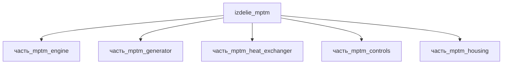

# Изделие: MPTM

## Описание

MPTM — модуль микрокогенерации на свободнопоршневом двигателе Стирлинга (референс: Microgen 1kW Linear FPEG): горение топлива запускает резонансный термоакустический контур двигателя, линейный альтернатор выдаёт 1050 Вт электрических (230 В, 50/60 Гц), пластинчатый теплообменник отводит ~6 кВт теплоты для отопления/ГВС. Электрическая выработка модуля 100–2000 Вт (линейка Microgen 1–2 кВт), тепловая 100–5000 Вт.

Полное наименование (как в CSV): `MPTM`

## Технические характеристики

| Параметр | Значение | Единица | Источник |
|---|---|---|---|
| подсистема | энергетическая | — | classify_subsystem |
| категория | прочее | — | — |
| выработка энергии (номинал) | 500 | W | средний режим когенерации; макс. генератора 1050 Вт (Microgen 1kW, 230 В, 50/60 Гц) |
| выработка тепла (номинал) | 1000 | W | тепловая мощность, отводимая теплообменником |

Электрическая энергия вырабатывается линейным альтернатором `часть_mptm_generator` (1050 Вт номинал — Microgen 1kW LFPSE); двигатель `часть_mptm_engine` производит механическую/акустическую мощность (поле выработка_энергии_W учитывает только электрическую генерацию), теплообменник и управление энергию не вырабатывают.

## Состав

Изделие верхнего уровня, 5 дочерних частей: [`часть_mptm_engine`](часть_mptm_engine/_index.md) — свободнопоршневой двигатель Стирлинга, [`часть_mptm_generator`](часть_mptm_generator/_index.md) — линейный альтернатор 1050 Вт, [`часть_mptm_heat_exchanger`](часть_mptm_heat_exchanger/_index.md) — пластинчатый теплообменник, [`часть_mptm_controls`](часть_mptm_controls/_index.md) — контроллер управления, [`часть_mptm_housing`](часть_mptm_housing/_index.md) — корпус.

## Используемые технологии

(Ссылки на реальные_данные/технологии/ добавляются после связывания)

## Используемые материалы

(Ссылки на реальные_данные/материалы/ добавляются после связывания)

## Принцип работы

Требует описания на основе инженерного анализа.

## Источники

- CSV: `начальные данные_final.csv` (пользовательский ввод)

---

## Декомпозиция

