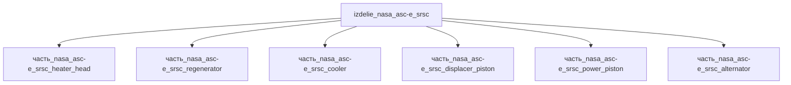

# Изделие: NASA ASC-e / SRSC

## Описание

NASA ASC-e / SRSC — компактный свободнопоршневой двигатель Стирлинга (FPSE) для космических радиоизотопных энергосистем. Две линии наследия в одном изделии: ASC-E2 (Sunpower/NASA Glenn: 84.5 Вт AC, КПД 37.7 %, T_нагрев 850 °C, масса 1.32 кг без интерфейсов генератора — Wong STAIF 2008) и SRSC — Sunpower Robust Stirling Convertor (гидростатические газовые подшипники, наследник ASC от программы ASRG; полётный дизайн 64 Вт / 3.4 кг / осевая длина 9.3 in = 236 мм, демонстрированный сброс тепла до 175 °C — Wilson NETS 2021; в DRPS-конфигурации SRSC #3/#4: 60 Вт, КПД 26 %, 3.6 кг). Огибающая корпуса: цилиндр длиной 236 мм, максимальный поперечный габарит 179 мм (монтажный фланец).

Полное наименование (как в CSV): `NASA ASC-e / SRSC — компактный FPSE`

## Технические характеристики

| Параметр | Значение | Единица | Источник |
|---|---|---|---|
| подсистема | энергетическая | — | canon |
| категория | энергетика | — | canon |
| подтип | Стирлинг_конвертер | — | canon |
| масса | 1–5 (номинал 3) | kg | Wong STAIF 2008 (ASC-E2 1.32 кг); Wilson NETS 2021 (SRSC 3.4 кг) |
| габариты (Д×Ш×В) | 179×179×236 | mm | Wilson NETS 2021 (длина 9.3 in; поперечник по CAD) |
| выработка энергии | 50–100 (номинал 80) | W | Wong STAIF 2008 (ASC-E2 84.5 Вт AC); Wilson NETS 2021 (SRSC 64 Вт) |
| выработка тепла | 200–400 (номинал 250) | W | canon |
| T_нагрев | 850 | °C | Wong STAIF 2008 (ASC-E2, MarM-247) |
| КПД | 38 | % | Wong STAIF 2008 (37.7 % ASC-E2) |

## Состав

Изделие верхнего уровня: 6 дочерних частей — heater_head (нагреватель, Inconel 625, доля массы 0.19), regenerator (рекуператор, сетка из нержавеющей стали, 0.095), displacer_piston (вытеснитель, Inconel 718, 0.18), power_piston (рабочий поршень, Inconel 718, 0.18), alternator (линейный генератор, медь, 0.18), cooler (охладитель, Al 6061-T6, 0.067).

## Используемые технологии

(Ссылки на реальные_данные/технологии/ добавляются после связывания)

## Используемые материалы

- `inconel_625` → [`материалы/inconel_625.md`](../../../материалы/inconel_625.md) — heater_head
- `stainless_steel_mesh` → [`материалы/stainless_steel_mesh.md`](../../../материалы/stainless_steel_mesh.md) — regenerator
- `inconel_718` → [`материалы/inconel_718.md`](../../../материалы/inconel_718.md) — displacer_piston, power_piston
- `copper` → [`материалы/copper.md`](../../../материалы/copper.md) — alternator
- `al_6061-t6` → [`материалы/al_6061-t6.md`](../../../материалы/al_6061-t6.md) — cooler

## Принцип работы

Свободнопоршневой цикл Стирлинга: рабочее тело (гелий) циркулирует между горячей полостью нагревателя (850 °C у ASC-E2, MarM-247; 720 °C в дизайне SRSC) и холодной полостью охладителя (~90 °C); вытеснитель перемещает газ через регенератор (прессованный войлок / намотанная сетка), накапливающий тепло между фазами; рабочий поршень связан с линейным альтернатором, преобразующим колебания в электроэнергию (64–84.5 Вт). Все узлы бесконтактные: гидростатические газовые подшипники SRSC обеспечивают многолетнюю работу без износа (наработка машин-предшественников ASC в лаборатории GRC превысила 11 лет); переразгон поршня гасится пассивной системой предотвращения столкновений; статическое центрирование поршня — пружиной. Тепло от GPHS-модуля подводится через теплоприёмник, сброс — через CSAF/охладитель (до 175 °C демонстрировано).

## Источники

- Wilson, S. — Stirling Technology Development, NETS 2021 (NTRS 20210014332): SRSC Flight Design 64 Вт / 3.4 кг / 9.3 in; SRSC #1 и #2 переданы GRC в окт. 2020; сброс тепла до 175 °C: https://ntrs.nasa.gov/citations/20210014332 (проверено 2026-11-08)
- Wong, W.; Wood, J. — Advanced Stirling Convertor, STAIF 2008 (NTRS 20090007956): ASC-E2 84.5 Вт AC, КПД 37.7 %, 850 °C, 1.32 кг: https://ntrs.nasa.gov/citations/20090007956 (проверено 2026-11-08)
- Wilson, S. — Stirling Power Conversion for Lunar Applications, CLPS 2022 (NTRS 20220018129): DRPS SRSC 60 Вт, КПД 26 %, 3.6 кг: https://ntrs.nasa.gov/citations/20220018129 (проверено 2026-11-08)
- CSV: `начальные данные_final.csv` (пользовательский ввод)

---

## Декомпозиция

