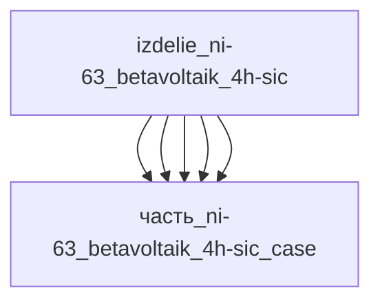

# Изделие: Ni-63 бетавольтаик 4H-SiC

## Описание

Бетавольтаический источник тока на изотопе никель-63 с широкозонным преобразователем 4H-SiC (технология Cornell/Widetronix). Электроосаждённая фольга ⁶³Ni (T½ 100.2 года, Eβ ср. 17.42 кэВ, макс. 66.7 кэВ) облучает p-n/p-i-n кристалл 4H-SiC (Eg 3.26 эВ); β-частицы создают электронно-дырочные пары в области перехода, встроенное поле разделяет заряды — электрический выход мкВт-класса (номинал 100 мкВт) при сроке службы порядка периода полураспада (десятилетия без обслуживания). Удельная мощность распада Ni-63 — 5.8 мВт/г: тепловыделение устройства номинально 5.8 мВт (фольга 1 г), отводится через подложку и титановый корпус.

Полное наименование (как в CSV): `Ni-63 бетавольтаик 4H-SiC`

## Технические характеристики

| Параметр | Значение | Единица | Источник |
|---|---|---|---|
| подсистема | энергетическая | — | classify_subsystem |
| категория | энергетика | — | canon |
| масса | 0.01 (0.005–0.05) | kg | canon |
| габариты (Д×Ш×В) | 20×20×2 | mm | canon |
| выработка энергии (эл.) | 0.0001 (0.00001–0.001) | W | µW-класс Ni-63/SiC (Widetronix Firefli-N 5–500 нВт/элемент) |
| выработка тепла | 0.0058 (0.0006–0.058) | W | распад Ni-63: 5.8 мВт/г × 1 г; диапазон = эл. выход / КПД ~1.7 % |
| изотоп | Ni-63, T½ 100.2 | лет | Spencer et al., Appl. Phys. Rev. 6, 031305 (2019) |
| средняя энергия β | 17.42 (макс. 66.7) | keV | Spencer et al. (2019) |
| КПД | ~1.7 (0.5–3.7) | % | Cornell APL 2006 — 3.7 %; Qiao CPL 2008 — 1.2 % |
| срок службы | ~100 | лет | T½ ⁶³Ni |

Тепло-баланс: Σ(детей) = 5.8 мВт (только изотопная фольга — источник распада) ≤ родителя 5.8 мВт; диод/подложка/заливка/корпус пассивны.

## Состав

Изделие верхнего уровня, 5 дочерних частей:

- `часть_ni-63_betavoltaik_4h-sic_isotope` — изотопная фольга Ni-63 5×5×0.1 мм (единственный источник тепла: 5.8 мВт распада);
- `часть_ni-63_betavoltaik_4h-sic_sic_diode` — кристалл 4H-SiC p-n/p-i-n диода 5×5×0.35 мм (преобразователь β-излучения, по теплу пассивен);
- `часть_ni-63_betavoltaik_4h-sic_substrate` — подложка 4H-SiC 20×20×0.35 мм (пассивный теплоотвод);
- `часть_ni-63_betavoltaik_4h-sic_encapsulant` — заливка эпоксидной смолой (пассивная);
- `часть_ni-63_betavoltaik_4h-sic_case` — корпус Ti-6Al-4V 20×20×2 мм (пассивный, отвод тепла в среду).

## Используемые материалы

- `ni-63` (электроосаждённая фольга изотопа) → [`ni-63.md`](../../../материалы/ni-63.md)
- `monokristallicheskogo_sic` (4H-SiC кристалл и подложка) → [`monokristallicheskogo_sic.md`](../../../материалы/monokristallicheskogo_sic.md)
- `ti-6al-4v` (корпус, AMS 4928) → [`ti-6al-4v.md`](../../../материалы/ti-6al-4v.md)
- `epoksid_epon_828_teta` (заливка) → [`epoksid_epon_828_teta.md`](../../../материалы/epoksid_epon_828_teta.md)

## Принцип работы

Прямое преобразование энергии радиоактивного распада в электричество (бетавольтаический эффект). Изотоп ⁶³Ni испытывает β-распад (⁶³Ni → ⁶³Cu + e⁻ + ν̄ₑ, T½ 100.2 года); β-электроны со средней энергией 17.42 кэВ (макс. 66.7 кэВ, пробег в SiC ~20 мкм) испускаются электроосаждённой фольгой и поглощаются в объёме кристалла 4H-SiC рядом с p-n (p-i-n) переходом, создавая электронно-дырочные пары (~1.9 эВ на пару при Eg 3.26 эВ); встроенное поле перехода разделяет пары и создаёт ЭДС (Uхх до 2–6 В в каскадах Widetronix). Широкая запрещённая зона 4H-SiC обеспечивает высокое Uхх, малые обратные токи и радиационную стойкость к β-повреждениям.

Энергетический баланс: при электрическом выходе 100 мкВт и КПД ~1.7 % (реальные Ni-63/SiC устройства — 1.2–3.7 %) мощность распада фольги 1 г составляет 5.8 мВт (удельная мощность Ni-63 — 5.8 мВт/г); вся непревращённая в электричество мощность выделяется теплом внутри устройства и отводится теплопроводностью через подложку 4H-SiC и корпус Ti-6Al-4V в окружающую среду. Поскольку β-распад не зависит от температуры и внешних условий, выход остаётся стабильным десятилетиями — за срок службы выделяется ~88 % активности, после чего мощность падает вдвое.

## Источники

- Spencer M.G. et al., «High-power direct energy conversion by nuclear batteries», Appl. Phys. Rev. 6, 031305 (2019) — ⁶³Ni: T½ 100.2 г, Eβ ср. 17.42 кэВ: https://pubs.aip.org/aip/apr/article/6/3/031305/123870
- Wang Y. et al., «Radioisotope batteries» (Innovation, 2025) — удельная мощность распада ⁶³Ni 5.80 мВт/г: https://www.the-innovation.org/article/doi/10.59717/j.xinn-energy.2025.100079
- Chandrashekhar M.V.S. et al., «Demonstration of a 4H SiC Betavoltaic Cell», APL 88, 033506 (2006) — КПД 3.7 %: https://doi.org/10.1063/1.2166699
- Qiao D.Y. et al., CPL 25 (2008) — Шоттки-вариант, КПД 1.2 %: https://cpl.iphy.ac.cn/en/article/id/42654
- Widetronix, Products — Firefli-N (⁶³Ni/4H-SiC, 5–500 нВт): https://www.widetronix.com/products
- Y.R. Uhm et al. — betavoltaic battery with ⁶³Ni foil (оптимальная толщина слоя ~2 мкм по самопоглощению): https://www.researchgate.net/publication/297672756_Study_of_a_Betavoltaic_Battery_Using_El (обращение 2026-11-09)
- J.J. Kim et al. — small-scale electroplating device for Ni-63 sealed foil source (фольга 4×4 мм², толщина покрытия 2.5–3.0 мкм): https://www.semanticscholar.org/paper/A-4H%E2%80%93SiC-betavoltaic-battery-based-on-a-63-N (обращение 2026-11-09)
- Ni-63 thin-film source for 4H-SiC betavoltaic: arXiv:1903.09098: https://arxiv.org/html/1903.09098v2
- CSV: `начальные данные_final.csv` (пользовательский ввод)

---

## Декомпозиция

