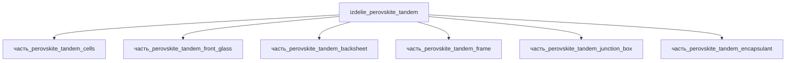

# Изделие: Perovskite tandem

## Описание

Perovskite tandem (солнечная ячейка)

Полное наименование (как в CSV): `Perovskite tandem (солнечная ячейка)`

## Технические характеристики

| Параметр | Значение | Единица | Источник |
|---|---|---|---|
| подсистема | энергетическая | — | classify_subsystem |
| категория | прочее | — | — |
| КПД модуля | 33 | % | canon (дополнительные; лабораторные рекорды тандемных ячеек LONGi/Oxford PV 28.6–34%) |
| выработка энергии | 300 (100–500) | W | canon; атрибуция — тандемный стек ячеек (F15d) |
| выработка тепла | 100 (50–200) | W | canon (диссипация поглощённой части спектра) |

(Параметры требуют уточнения через веб-поиск и вычислений; см. fc_изделие_масса, fc_изделие_стандарты в _field_contracts.yaml)

## Состав

Изделие верхнего уровня (уровень 1). Дочерние части:

- `часть_perovskite_tandem_cells` — тандемный стек ячеек (перовскит + Si HJT), **генератор энергии 300 Вт**;
- `часть_perovskite_tandem_front_glass` — фронтальное низкожелезистое стекло;
- `часть_perovskite_tandem_backsheet` — тыльная подложка (Tedlar/PET);
- `часть_perovskite_tandem_frame` — алюминиевая рама (Al 6063-T5 экструдированный профиль);
- `часть_perovskite_tandem_junction_box` — соединительная коробка;
- `часть_perovskite_tandem_encapsulant` — инкапсулянт (EVA).

Энергобаланс (F15d): Σ(выработка_энергии детей) = 300 Вт (только стек ячеек) ≥ выработка_энергии родителя 300 Вт ✓; остальные части — пассивные (0 Вт).

## Используемые технологии

(Ссылки на реальные_данные/технологии/ добавляются после связывания)

## Используемые материалы

(Ссылки на реальные_данные/материалы/ добавляются после связывания)

## Принцип работы

Перовскитно-кремниевый тандемный фотоэлектрический модуль (референс Oxford PV, IEC 61215/61730): монолитный 2-контактный стек — верхний перовскитный подэлемент (широкая запрещённая зона ~1.68 эВ) поглощает синюю/зелёную часть солнечного спектра, нижний кремниевый HJT-подэлемент (~1.12 эВ) — красную/ИК; последовательно включённые переходы суммируют напряжения и поднимают КПД выше предела одиночного кремния (рекорды: 28.6% ячейка NREL-certified 2023; 25% / 421 Вт полномасштабный модуль 1.68 м² Fraunhofer ISE 2024; 26.9% 60-ячеечный модуль 2024). Остальные части пакета (стекло/инкапсулянт/подложка/рама/коробка) обеспечивают оптический ввод, изоляцию и механическую защиту; поглощённое вне генерации тепло диссипируется (~100 Вт canon).

## Источники

- Oxford PV / Fraunhofer ISE, «Full-sized tandem PV module» (2024-01-31): 25% КПД, 421 Вт на 1.68 м² — https://www.oxfordpv.com/press-releases/oxford-pv-solar-sustainability-initiative (обращение 2026-11-08)
- PV-Tech, «Oxford PV unveils record 26.9% perovskite tandem module» (2024-06-19): https://www.pv-tech.org/oxford-pv-unveils-record-26-9-perovskite-tandem-module (обращение 2026-11-08)
- CSV: `начальные данные_final.csv` (пользовательский ввод) — canon: КПД 33%, 300 Вт, Oxford PV perovskite-on-silicon tandem

---

## Декомпозиция

