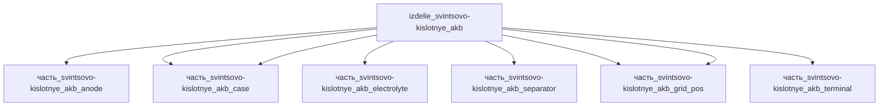

# Изделие: свинцово-кислотные АКБ

## Описание

свинцово-кислотные АКБ

Полное наименование (как в CSV): `свинцово-кислотные АКБ`

## Технические характеристики

| Параметр | Значение | Единица | Источник |
|---|---|---|---|
| подсистема | энергетическая | — | classify_subsystem |
| категория | прочее | — | — |

(Параметры требуют уточнения через веб-поиск и вычислений; см. fc_изделие_масса, fc_изделие_стандарты в _field_contracts.yaml)

## Энергетический баланс (F15d)

Источник отдачи батареи — электрохимическая пара «губчатый Pb (отрицательная пластина) ↔ PbO2 (положительная пластина)»: суммарная ЭДС ячейки E° = 2.05 В (Wikipedia, Lead–acid battery). Учётная мощность пары: 250 Вт (PbO2-пластина) + 250 Вт (Pb-пластина) = 500 Вт — номинал родителя. Ток разряда при номинале: I = P/U = 500/12 ≈ 41.7 А (≈0.42C для 100 Ач); через обе пластины течёт один и тот же ток, мощность пары делится между активными массами поровну (канон-модель, аналогично izdelie_tverdotelnye_akkumulyatory). Пассивные части (электролит, сепаратор, решётки, корпус, клемма) энергию не генерируют — выработка_энергии_W = 0.

## Тепловой баланс (F15b)

Тепловыделение при разряде аппроксимируется I²R (Battery University BU-802a — принятая производителями оценка). При I = 41.7 А и распределённом внутреннем сопротивлении R_eff ≈ 5.1 мОм потери детей:

| Часть | Тепло, Вт | Механизм |
|---|---|---|
| электролит (H2SO4) | 3.0 | ионная омическая составляющая |
| анод (PbO2-пластина) | 2.5 | омические потери пасты + перенапряжение восстановления |
| катод (Pb-пластина) | 2.0 | омические потери пасты + перенапряжение окисления |
| решётка (Pb-Sb) | 0.6 | омические потери сплава токоотвода (на экземпляр) |
| клемма | 0.5 | контактные + омические потери вывода |
| сепаратор (AGM) | 0.2 | джоулево тепло порового электролита |
| корпус (PP) | 0 | пассивный контейнер, ток не проводит |

Σ детей = 8.8 Вт ≤ номинала родителя 10 Вт — F15b выполнено (запас 1.2 Вт — собственный нагрев межэлементных соединений). При максимальной отдаче 1000 Вт (I = 83.3 А) I²R ≈ 35 Вт ≤ max 50 Вт родителя — согласовано.

## Состав

Изделие верхнего уровня. Дочерние части не указаны (требуется декомпозиция).

## Используемые технологии

(Ссылки на реальные_данные/технологии/ добавляются после связывания)

## Используемые материалы

(Ссылки на реальные_данные/материалы/ добавляются после связывания)

## Принцип работы

Требует описания на основе инженерного анализа.

## Источники

- CSV: `начальные данные_final.csv` (пользовательский ввод)

---

- Wikipedia — Lead–acid battery (E°cell = 2.05 В; КПД заряда/разряда 50–95 %; реакции пластин Pb/PbO2): https://en.wikipedia.org/wiki/Lead%E2%80%93acid_battery (обращение 2026-11-07)
- Battery University BU-802a — How does Rising Internal Resistance Affect Performance (I²R — принятая производителями оценка тепловыделения при разряде): https://batteryuniversity.com/article/bu-802a-how-does-rising-internal-resistance-affect-performance (обращение 2026-11-07)

## Декомпозиция

