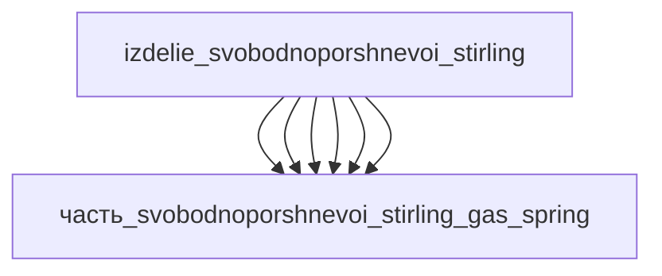

# Изделие: Свободнопоршневой Стирлинг

## Описание

Свободнопоршневой двигатель Стирлинга (FPSE, Free-Piston Stirling Engine) — герметичная машина Стирлинг-цикла без кривошипно-шатунного механизма: единственная подвижная система «вытеснитель–поршень» совершает свободное резонансное движение на газовых подшипниках, а линейный альтернатор движущегося магнита преобразует механическую энергию прямо в электричество. Референсы класса 1 кВт: NASA RE-1000 (1 кВт-класс, Sunpower Inc., Athens, Ohio / NASA Lewis, 1983, TM-83471) и Sunpower EG-1000 (>1 кВт эл., 240 В / 50 Гц). Отсутствие трущихся уплотнений и кривошипа даёт высокий ресурс (MTTF > 200 000 ч у компонентов — CryoTel GT), бесшумность и надёжность — основание применения в космических энергоблоках (NASA GRC) и когенерационных установках.

Полное наименование (как в CSV): `Свободнопоршневой Стирлинг (FPSE)`

## Технические характеристики

| Параметр | Значение | Единица | Источник |
|---|---|---|---|
| подсистема | энергетическая | — | classify_subsystem |
| выработка энергии (электр.) | 100–1000, номинал 500 | W | RE-1000 (1 кВт-класс, NASA TM-83471); Sunpower EG-1000 (>1 кВт эл.) |
| выработка тепла (отвод) | 200–2000, номинал 1000 | W | тепловой баланс: при 500 Вт эл. и КПД ~30 % тепловой вход ~1.7 кВт, отвод ~1 кВт |
| КПД (тепло → электричество) | ~30 | % | Qiu & Solomon 2018 (IntechOpen) |
| температура нагревателя | 650 | °C | NASA TM-83471 (RE-1000) |
| рабочее тело / давление / частота | гелий / 7 МПа / 30 Гц | — | NASA TM-83471 (RE-1000) |
| масса | 10 (диапазон 1–50) | kg | canon |
| габариты (Д×Ш×В) | 300×200×200 | mm | canon (оценка компоновки) |

## Состав

Изделие верхнего уровня (уровень 1). Шесть дочерних частей:

- `часть_svobodnoporshnevoi_stirling_heater` — нагреватель (heater head, 34 трубки Inconel 718)
- `часть_svobodnoporshnevoi_stirling_regenerator` — регенератор (кольцевая матрица ss_316l)
- `часть_svobodnoporshnevoi_stirling_cooler` — охладитель (референс Sunpower CryoTel GT)
- `часть_svobodnoporshnevoi_stirling_piston` — рабочий поршень (газовые подшипники)
- `часть_svobodnoporshnevoi_stirling_alternator` — линейный альтернатор (NdFeB, moving-magnet)
- `часть_svobodnoporshnevoi_stirling_gas_spring` — газовая пружина (bounce space)

## Используемые технологии

(Ссылки на реальные_данные/технологии/ добавляются после связывания)

## Используемые материалы

- `inconel_718` — трубки нагревателя и силовой поршень (ASTM B637 / AMS 5662)
- `ss_316l` — матрица регенератора (случайноволокнистый войлок Bekaert Bekipor)
- `ss_aisi_304` — герметичные корпуса охладителя и газовой пружины
- `al_6061-t6` — поршень (низкая плотность)
- `ndfeb` — магниты линейного альтернатора
- `copper` — катушка альтернатора

## Принцип работы

Цикл Стирлинга в герметичном контуре с гелием под средним давлением ~7 МПа: внешний источник тепла (горелка, солнечный концентратор, радиоизотоп или сбросное тепло) нагревает трубки heater head до 650 °C; вытеснитель перегоняет газ через регенератор (тепловой аккумулятор — пористая стальная матрица) из горячей полости в холодную и обратно: газ расширяется в горячей полости (рабочий ход) и сжимается в холодной, охладитель поддерживает температурный градиент. Поршень совершает свободное резонансное движение (~30 Гц у RE-1000); газовая пружина (bounce space) под поршнем задаёт упругость резонансной системы. NdFeB-магниты на штоке поршня движутся сквозь катушку линейного альтернатора, наводя ЭДС; электрическая нагрузка демпфирует резонанс. Газовые подшипники и зазорные уплотнения исключают трение и износ — отсюда ресурс и бесшумность машины.

## Источники

- NASA TM-83471 / J. Schreiber, «Testing and Performance Characteristics of a 1-kW Free Piston Stirling Engine» (NASA Lewis Research Center, 1983): https://ntrs.nasa.gov/api/citations/19830016765/downloads/19830016765.pdf (обращение 2026-11-08)
- S. Qiu, A. Solomon, «Free-Piston Stirling Engine Generators», IntechOpen, 2018: https://dx.doi.org/10.5772/intechopen.79413 (обращение 2026-11-08)
- J. Wood, NASA/CR—2010-216750 (Sunpower FSP convertor — поршень/регенератор): https://ntrs.nasa.gov/api/citations/20100031133/downloads/20100031133.pdf (обращение 2026-11-08)
- CSV: `начальные данные_final.csv` (пользовательский ввод)

---

## Декомпозиция

