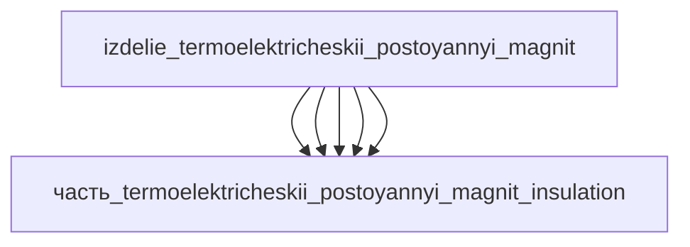

# Изделие: термоэлектрический постоянный магнит

## Описание

термоэлектрический постоянный магнит

Полное наименование (как в CSV): `термоэлектрический постоянный магнит`

Термоэлектрический генератор (ТЭГ): сборка прямого преобразования теплового потока в электричество по эффекту Зеебека. Батарея из 15 Bi₂Te₃-модулей TXL-127-25Q (40×40×4.7 мм, по 127 термопар p-n) зажата между горячим теплосьёмником и холодным радиатором с посадочным контуром 40×40 мм; аэрогелевая изоляция Pyrogel XTE отсекает паразитные тепловые шунты, прижим 8× M4 A2-70 поддерживает контактное давление ~1 МПа. При T_гор до 250 °C и КПД 8% (модульный КПД BiTe — Nozariasbmarz 2020) номинальный тепловой поток 12.5 Вт → 1.0 Вт электричества (диапазон 0.01–10 Вт); масса 0.5 кг.

## Технические характеристики

| Параметр | Значение | Единица | Источник |
|---|---|---|---|
| подсистема | энергетическая | — | classify_subsystem |
| категория | энергетика | — | canon |
| габариты (Д×Ш×В) | 50×50×5 | mm | оценка — посадочный контур батареи 15× TXL-127-25Q (40×40 мм) и изоляции 60×60 мм с запасом |
| выработка энергии | 1.0 | W | spec II-VI Marlow TEG; КПД 8% при T_гор 250°C подтверждён для BiTe-модулей (Nozariasbmarz 2020) |
| выработка тепла (тепловой поток) | 12.5 | W | Q_гор = P_эл/η = 1.0/0.08 — КПД 8% (Nozariasbmarz 2020, DOI 10.1016/j.isci.2020.101340) |

## Состав

Изделие верхнего уровня (энергетическая подсистема). 5 дочерних частей: горячий теплосьёмник (`часть_..._heat_sink_hot`, ребристый профиль 40×40×20 мм), батарея ТЕГ-модулей (`часть_..._teg_modules`, 15× TXL-127-25Q), холодный радиатор (`часть_..._heat_sink_cold`, 40×40×3 мм), прижимной крепёж (`часть_..._clamping`, 8× M4 A2-70), аэрогелевая изоляция (`часть_..._insulation`, Pyrogel XTE 60×60×40 мм).

## Используемые технологии

(Ссылки на реальные_данные/технологии/ добавляются после связывания)

## Используемые материалы

(Ссылки на реальные_данные/материалы/ добавляются после связывания)

## Принцип работы

Внешний источник тепла (T_гор до 250 °C) через горячий теплосьёмник создаёт продольный градиент температуры на батарее ТЕГ-модулей; в 127×15 термопарах p-Bi₂Te₃/n-Bi₂Te₃ эффект Зеебека возбуждает термо-ЭДС, максимум съёма мощности — при согласовании нагрузки с внутренним сопротивлением 4.9 Ом модуля (PML 119 мВт @ ΔT=30 °C с модуля → 1.785 Вт с батареи). Не преобразованная в электричество часть потока (Q_хол = Q_гор − P_эл ≈ 11.5 Вт при номинале) рассеивается холодным радиатором; изоляция минимизирует тепловые шунты, прижимной крепёж компенсирует термоциклирование стека.

## Источники

- CSV: `начальные данные_final.csv` (пользовательский ввод)
- Nozariasbmarz A. et al. — Bismuth Telluride Thermoelectrics with 8% Module Efficiency for Waste Heat Recovery, iScience 23 (2020), DOI 10.1016/j.isci.2020.101340: https://www.sciencedirect.com/science/article/pii/S2589004220305277 (проверено 2026-11-08)
- TXL-127-25Q TEG 40×40 мм — 127 пар Bi2Te3, VOC 1.5 В / ISC 311 мА / PML 119 мВт @ ΔT=30 °C, до 125 °C: https://customthermoelectric.com/txl-127-25qteg-40-x-40mm.html (проверено 2026-11-08)

---

## Декомпозиция

