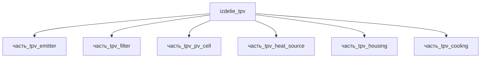

# Изделие: TPV

## Описание

Термофотоэлектрический (TPV) генератор — твердотельный преобразователь тепла в электричество: источник тепла (SiC) разогревает вольфрамовый излучатель до 1200–1500 °C, ИК-фотоны проходят селективный фильтр (возврат субзапрещённых фотонов к излучателю) и преобразуются узкозонными ячейками GaSb/InGaAsSb в электричество. Канон модуля: **10 Вт электричества при 50 Вт тепла** (КПД 20–30 %). Рекорд отрасли — 39.3 ± 1 % на двухпереходных III-V тандемных ячейках с задним отражателем (MIT/NREL, LaPotin et al., Nature 613, 2022; W-эмиттер 2127 °C, 1.8–2.39 Вт/см²). Референс конструкции — «zero-vacuum gap» (Cui Research Group): зазор излучатель-ячейка сведён к минимуму для максимизации плотности потока.

Полное наименование (как в CSV): `TPV — Термофотovoltaический преобразователь на «zero-vacuum gap» конструкции от Cui Research Group`

## Технические характеристики

| Параметр | Значение | Единица | Источник |
|---|---|---|---|
| подсистема | энергетическая | — | classify_subsystem |
| категория | энергетика | — | canon |
| выработка энергии | 10 | W | canon (pv_cell — фактический выход модуля) |
| выработка тепла | 50 | W | canon (heat_source — весь тепловой поток) |
| КПД | 30 | % | canon; GaSb TPV 20–30 %, рекорд 39.3 % (Nature 613, 2022) |
| температура излучателя | 1500 | °C | canon; W-эмиттер 1200–1500 °C (PMC9007744) |
| удельная мощность | 1.8–2.39 | Вт/см² | LaPotin et al., Nature 613 (2022) |

(Параметры требуют уточнения через веб-поиск и вычислений; см. fc_изделие_масса, fc_изделие_стандарты в _field_contracts.yaml)

## Состав

Изделие верхнего уровня, 6 частей (уровень 2): heat_source (источник тепла SiC, 50 Вт — весь тепловой поток), emitter (W-излучатель, перенос в ИК), filter (селективный возврат субзапрещённых фотонов), pv_cell (GaSb/InGaAsSb, 10 Вт электричества — фактический выход), cooling (отвод остаточного тепла), housing (корпус). Энергобаланс: 50 Вт тепла → 10 Вт электричества + ~40 Вт остатка на охлаждение.

## Используемые технологии

(Ссылки на реальные_данные/технологии/ добавляются после связывания)

## Используемые материалы

(Ссылки на реальные_данные/материалы/ добавляются после связывания)

## Принцип работы

Цепочка энергопреобразования: (1) heat_source выделяет 50 Вт тепла и разогревает излучатель; (2) вольфрамовый emitter при 1200–1500 °C излучает ИК-спектр (закон Планка); (3) селективный filter пропускает фотоны выше запрещённой зоны ячейки и возвращает субзапрещённые излучателю (рекуперация); (4) pv_cell (база InGaAsSb 0.53 эВ, окно AlGaAsSb) генерирует 10 Вт электричества; (5) cooling отводит не преобразованное тепло (~40 Вт). Энергобаланс F15d: родитель 10 Вт ≤ Σ генерирующих детей (heat_source 50 + pv_cell 10 = 60 Вт) — потери на преобразование КПД ~20 %.

## Источники

- LaPotin A. et al., «Thermophotovoltaic efficiency of 40%», Nature 613 (2023): 39.3 ± 1 % КПД, W-эмиттер 2127 °C, 1.8 Вт/см²: https://www.nature.com/articles/s41586-022-04473-y (обращение 2026-11-07)
- Обзор TPV Energy Conversion (PMC9007744): W-эмиттер 1200–1500 K, GaSb ячейки, селективные фильтры: https://pmc.ncbi.nlm.nih.gov/articles/PMC9007744 (обращение 2026-11-07)
- CSV: `начальные данные_final.csv` (пользовательский ввод)

---

## Декомпозиция

