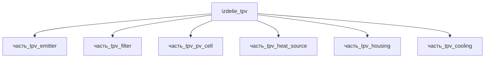

# Изделие: TPV

## Описание

Термофотоэлектрический (TPV) генератор — твердотельный преобразователь тепла в электричество: источник тепла (SiC) разогревает вольфрамовый излучатель до 1200–1500 °C, ИК-фотоны проходят селективный фильтр (возврат субзапрещённых фотонов к излучателю) и преобразуются узкозонными ячейками GaSb/InGaAsSb в электричество. Канон модуля: **10 Вт электричества при 50 Вт тепла** (КПД 20–30 %). Рекорд отрасли — 39.3 ± 1 % на двухпереходных III-V тандемных ячейках с задним отражателем (MIT/NREL, LaPotin et al., Nature 613, 2022; W-эмиттер 2127 °C, 1.8–2.39 Вт/см²). Референс конструкции — «zero-vacuum gap» (Cui Research Group): зазор излучатель-ячейка сведён к минимуму для максимизации плотности потока.

Полное наименование (как в CSV): `TPV — Термофотovoltaический преобразователь на «zero-vacuum gap» конструкции от Cui Research Group`

## Технические характеристики

| Параметр | Значение | Единица | Источник |
|---|---|---|---|
| подсистема | энергетическая | — | classify_subsystem |
| категория | энергетика | — | canon |
| выработка энергии | 10 | W | canon (pv_cell — фактический выход модуля) |
| выработка тепла | 50 | W | canon (heat_source — весь тепловой поток) |
| КПД | 30 | % | canon; GaSb TPV 20–30 %, рекорд 39.3 % (Nature 613, 2022) |
| температура излучателя | 1500 | °C | canon; W-эмиттер 1200–1500 °C (PMC9007744) |
| удельная мощность | 1.8–2.39 | Вт/см² | LaPotin et al., Nature 613 (2022) |
| габариты | 400 × 100 × 30 | мм | сборочная огибающая детей (F15g): лента эмиттера 400 мм, теплоисточник SiC h=30 мм |

(Параметры требуют уточнения через веб-поиск и вычислений; см. fc_изделие_масса, fc_изделие_стандарты в _field_contracts.yaml)

## Состав

Изделие верхнего уровня, 6 частей (уровень 2): heat_source (источник тепла SiC, 50 Вт — весь тепловой поток), emitter (W-излучатель, перенос в ИК), filter (селективный возврат субзапрещённых фотонов), pv_cell (GaSb/InGaAsSb, 10 Вт электричества — фактический выход), cooling (отвод остаточного тепла), housing (корпус). Энергобаланс: 50 Вт тепла → 10 Вт электричества + ~40 Вт остатка на охлаждение.

## Используемые технологии

| Технология | Часть | Назначение |
|---|---|---|
| `vakuumnoe_spekanie` | emitter (W) | порошковая металлургия вольфрама: прессование и вакуумное спекание W-заготовки под последующий прокат в фольгу (ASTM B760) |
| `cvd` (MOCVD) | pv_cell (InGaAsSb) | MOCVD-эпитаксия P/N-ячейки In₀.₁₆Ga₀.₈₄As₀.₁₄Sb₀.₈₆ (Eg 0.53 эВ) на GaSb-подложке (вариант mocvd_ingaassb_053ev) |
| `vakuumnoe_spekanie` | heat_source (SiC) | бездавленное спекание SSiC (pressureless sintered): радиантные трубки/теплоисточник до 1650 °C |

(Ссылки на реальные_данные/технологии/: tekhnologia_vakuumnoe_spekanie, tekhnologia_cvd)

## Используемые материалы

| Материал | Часть | Форма |
|---|---|---|
| `tungsten` (ASTM B760) | emitter 28.5 % | фольга_плита_ASTM_B760 — кованый W-прокат до фольги 0.05–0.3 мм, селективные эмиттеры TPV 1200–1800 K |
| `ingaassb` | pv_cell 13.5 % | mocvd_ingaassb_053ev — MOCVD-ячейка Eg 0.53 эВ на GaSb (λcutoff ≈ 2.4 мкм) |
| `silicon_carbide` (SSiC) | heat_source 36 % | теплоисточник_tpv — спечённый поликристаллический SiC до 1600–1650 °C |

Наследуемые (агрегация детских BOM × родительские доли): tasi2 (покрытие эмиттера, 0.285 ← emitter), ingaassb (0.135 ← pv_cell), karbon (0.36 ← heat_source). Части без родительской доли (filter — quartz, housing — ti-6al-4v, cooling — al_6061-t6) не агрегируются.

(Ссылки на реальные_данные/материалы/: material_tungsten, material_ingaassb, material_silicon_carbide)

## Принцип работы

Цепочка энергопреобразования: (1) heat_source выделяет 50 Вт тепла и разогревает излучатель; (2) вольфрамовый emitter при 1200–1500 °C излучает ИК-спектр (закон Планка); (3) селективный filter пропускает фотоны выше запрещённой зоны ячейки и возвращает субзапрещённые излучателю (рекуперация); (4) pv_cell (база InGaAsSb 0.53 эВ, окно AlGaAsSb) генерирует 10 Вт электричества; (5) cooling отводит не преобразованное тепло (~40 Вт). Энергобаланс F15d: родитель 10 Вт ≤ Σ генерирующих детей (heat_source 50 + pv_cell 10 = 60 Вт) — потери на преобразование КПД ~20 %.

## Источники

- LaPotin A. et al., «Thermophotovoltaic efficiency of 40%», Nature 613 (2023): 39.3 ± 1 % КПД, W-эмиттер 2127 °C, 1.8 Вт/см²: https://www.nature.com/articles/s41586-022-04473-y (обращение 2026-11-07)
- Обзор TPV Energy Conversion (PMC9007744): W-эмиттер 1200–1500 K, GaSb ячейки, селективные фильтры: https://pmc.ncbi.nlm.nih.gov/articles/PMC9007744 (обращение 2026-11-07)
- Stelmakh V. et al. (MIT), «Performance of tantalum-tungsten alloy selective emitters for thermophotovoltaics» (2014) — металлические фотонные кристаллы/селективные эмиттеры TPV: https://dspace.mit.edu/entities/publication/e89d7318-4cbd-46fd-a131-a6c9b07da5ab (обращение 2026-11-09)
- Fraas L.M., NASA NTRS 20000033728 — вольфрам как селективный металлический эмиттер TPV-генератора: https://ntrs.nasa.gov/citations/20000033728 (обращение 2026-11-09)
- AT&T Elements — SSiC (pressureless sintered SiC) radiant tubes, стабильная работа до 1650 °C в коррозионных средах: https://www.attelements.com/ceramics/silicon-carbide-radiant-tubes-ssic.html (обращение 2026-11-09)
- Cao Y. et al., «A tungsten-based metamaterial emitter for solar thermophotovoltaic systems» (2024) — W-метаматериальные селективные эмиттеры TPV: https://pubmed.ncbi.nlm.nih.gov/38666381 (обращение 2026-11-09)
- CSV: `начальные данные_final.csv` (пользовательский ввод)

---

## Декомпозиция

