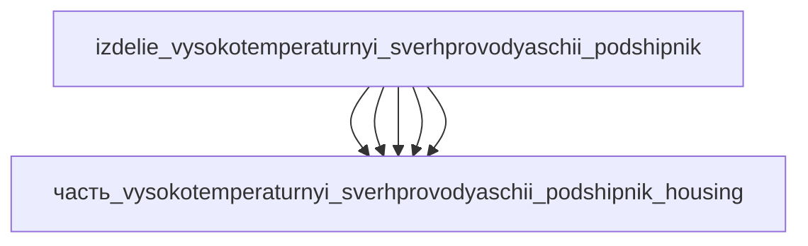

# Изделие: Высокотемпературный сверхпроводящий подшипник

## Описание

Высокотемпературный сверхпроводящий подшипник (HTS)

Полное наименование (как в CSV): `Высокотемпературный сверхпроводящий подшипник (HTS)`

## Технические характеристики

| Параметр | Значение | Единица | Источник |
|---|---|---|---|
| подсистема | энергетическая | — | classify_subsystem |
| категория | прочее | — | — |
| выработка тепла (номинал) | 1.5 | W | баланс: теплоприток криостата 1.0 + потери YBCO 0.3 + собственные 0.2 |
| выработка тепла (мин/макс) | 1.05 / 3 | W | мин: только теплоприток при 0 об/мин; макс: 10000 об/мин (масштаб Murakami 2002: 8 Вт при 6000 об/мин, класс 838 Н) |
| рабочая температура | −196 (77 K) | °C | LN2-криостат |
| критические обороты | 10000 | об/мин | canon (Boeing HTS bearing research) |

(Параметры требуют уточнения через веб-поиск и вычислений; см. fc_изделие_масса, fc_изделие_стандарты в _field_contracts.yaml)

## Состав

Изделие верхнего уровня. Дочерние части (уровень 2):

- `часть_vysokotemperaturnyi_sverhprovodyaschii_podshipnik_hts_element` — массивный YBCO-статор 30×30×15 мм (гистерезисные/вихревые потери 0.3 Вт)
- `часть_vysokotemperaturnyi_sverhprovodyaschii_podshipnik_magnet` — сегментированный NdFeB-ротор Ø150/Ø90×45 мм (пассивный, 0 Вт)
- `часть_vysokotemperaturnyi_sverhprovodyaschii_podshipnik_cryostat` — вакуумный LN2-криостат 170×170×90 мм (статический теплоприток 1.0 Вт)
- `часть_vysokotemperaturnyi_sverhprovodyaschii_podshipnik_shaft` — вал (пассивный, 0 Вт)
- `часть_vysokotemperaturnyi_sverhprovodyaschii_podshipnik_housing` — корпус (пассивный, 0 Вт)

## Используемые технологии

(Ссылки на реальные_данные/технологии/ добавляются после связывания)

## Используемые материалы

(Ссылки на реальные_данные/материалы/ добавляются после связывания)

## Принцип работы

Ротор (NdFeB-кольцо + вал) левитирует над массивными YBCO-блоками (эффект Мейснера + пиннинг потока, field-cooled режим): механический контакт отсутствует, сухое трение равно нулю. Тепловой баланс изделия — суммарная криогенная нагрузка, снимаемая криоохладителем/испарением LN2: (1) статический теплоприток в криостат ~1 Вт — излучение на полированных стенках + кондукция через опоры и заливные трубопроводы (вакуум 5×10⁻³ Торр устраняет конвекцию); (2) вращательные потери в YBCO-статоре ~0.3 Вт при номинальных оборотах — гистерезисные и вихревые потери от неоднородности поля сегментированного ротора (доминирующий механизм вращательных потерь HTS-подшипников — Deng 2015; при 6000 об/мин для класса 838 Н измерено 8.03 Вт — Murakami 2002); (3) собственные потери ~0.2 Вт (эдди в углепластиковом бандаже ротора, ветровые в вакууме — пренебрежимо малы). Сверхпроводник омических потерь не имеет (DC-режим пиннинга) — поэтому потери статора на порядки ниже обычных магнитных подшипников, а основную долю нагрузки даёт криостат.

## Источники

- CSV: `начальные данные_final.csv` (пользовательский ввод)
- Murakami A. et al., «Fabrication and evaluation of superconducting bearing» / Proc. of SMB, Physica C 378–381 (2002) 883 — вращательные потери SMB 8.03 Вт при 6000 об/мин (нагрузка 838 Н), главный механизм — неоднородность магнитного поля — https://ui.adsabs.harvard.edu/abs/2002PhyC..378..883M (обращение 2026-11-08)
- Deng Z. et al. (2015), «Effect of anisotropic magnetization on the rotational loss in YBCO bulk» — эдди-потери от неоднородного поля — один из главных механизмов вращательных потерь HTS-подшипника (обращение 2026-11-08)
- Werfel F.N. et al., «Application Advances in HTS Bearing Technology» — инкапсулированные HTS-подшипники: вакуумный криостат, отсечка излучения и газовой кондукции при 77 К (обращение 2026-11-08)

---

## Декомпозиция

