# Изделие-обёртка: SkyNet-HKAerial

## Описание

Wrapper-изделие для модели `SkyNet-HKAerial` (тип: воздушный, подсистема: каркас).

Создано для поддержки декомпозиции: дочерние части (часть_*) ссылаются на
этот id как на родителя. Сама модель остаётся в фантастические данные/модели/.

## Декомпозиция

```mermaid
graph TD
    HKAerial["SkyNet-HKAerial"]
    hk_aerial_фюзеляж["часть_hk_aerial_фюзеляж"]
    HKAerial --> hk_aerial_фюзеляж
    hk_aerial_двигатель_левый["часть_hk_aerial_двигатель_левый"]
    HKAerial --> hk_aerial_двигатель_левый
    HKAerial --> hk_aerial_двигатель_правы
    hk_aerial_сенсоры["часть_hk_aerial_сенсоры"]
    HKAerial --> hk_aerial_сенсоры
    hk_aerial_плазма_пушка["часть_hk_aerial_плазма_пушка"]
    HKAerial --> hk_aerial_плазма_пушка
    hk_aerial_навигация["часть_hk_aerial_навигация"]
    HKAerial --> hk_aerial_навигация
    hk_aerial_связь["часть_hk_aerial_связь"]
    HKAerial --> hk_aerial_связь
    hk_aerial_крылья["часть_hk_aerial_крылья"]
    HKAerial --> hk_aerial_крылья
```

## Состав

Дочерние части:
- `часть_hk_aerial_фюзеляж`
- `часть_hk_aerial_двигатель_левый`
- `часть_hk_aerial_сенсоры`
- `часть_hk_aerial_плазма_пушка`
- `часть_hk_aerial_навигация`
- `часть_hk_aerial_связь`
- `часть_hk_aerial_крылья`

## Связанная модель

- [`SkyNet-HKAerial`](../../../../фантастические%20данные/модели/hk_aerial) — модель SkyNet

## Источники

- Wrapper-изделие создано автоматически (2026-11-03) для поддержки декомпозиции
