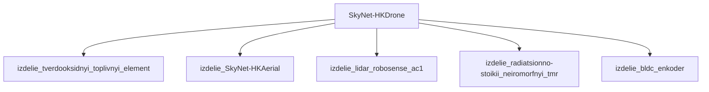

## Описание

HK-Drone — малый беспилотник; винтокрылый; автономный патруль; не имеет оружия или лёгкое.

## Технические характеристики

| Параметр | Значение | Единица | Источник |
|---|---|---|---|
| масса | 100.0–200.0 (номинал 136.0) | kg | canon |
| тип узла | модель_SkyNet | — | canon |
| уровень_номер | 1 | — | canon |

## Источники

- Канон: T2: Judgment Day (1991), T: Salvation (2009)

## Декомпозиция

## Источник канон

- **Произведение:** T2: Judgment Day (1991), T: Salvation (2009)
- **Тип:** фильм
- **Каноничность:** canon

## Тактико-технические характеристики

| Параметр | Значение |
|---|---|
| размах_крыльев_м | 3 |
| масса_кг | 80 |
| производитель | Скайнет |
| класс | воздушный |
| категория | воздушный_HK |
| тип_модели | воздушный |

## Подсистемы (по типу)

- вычислительная
- энергетическая
- каркас
- броня
- маскировка
- сенсоры
- приводная_система
- система_связи
- навигация
- система_охлаждения
- система_питания
- система_передвижения

## Многослойная броня (§11.6)

Минимум слоёв по типу: 2 (§11.6). Макс. доля массы брони: 15%.

1. Al 6061-T6 (лёгкий кин.) (`al_6061_t6`)
2. UHMWPE (энергопоглощение) (`uhmwpe_dyneema`)

## Произведения, где появляется

- ✅ `work_002` — «Terminator 2: Judgment Day» (1991) → [`work_002.md`](../произведения/work_002.md)
- ✅ `work_004` — «Terminator Salvation» (2009) → [`work_004.md`](../произведения/work_004.md)
- 📚 `work_045` — «Terminator: Salvation (game)» (2009) → [`work_045.md`](../произведения/work_045.md)
