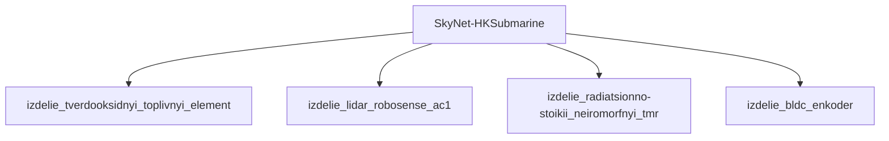

## Описание

Hunter-Killer Submarine — подводный охотник; SONAR; ракетное вооружение; упоминается в каноне T1.

## Технические характеристики

| Параметр | Значение | Единица | Источник |
|---|---|---|---|
| масса | 50000.0–200000.0 (номинал 100000.0) | kg | canon |
| тип узла | модель_SkyNet | — | canon |
| уровень_номер | 1 | — | canon |

## Источники

- Канон: The Terminator (1984) [mentioned]

## Декомпозиция

## Источник канон

- **Произведение:** The Terminator (1984) [mentioned]
- **Тип:** фильм
- **Каноничность:** canon

## Тактико-технические характеристики

| Параметр | Значение |
|---|---|
| рабочая_глубина_м | 300 |
| масса_кг | 25000 |
| производитель | Скайнет |
| класс | водный_подводный |
| категория | водный_HK |
| тип_модели | водный_подводный |

## Подсистемы (по типу)

- вычислительная
- энергетическая
- каркас
- броня
- маскировка
- сенсоры
- приводная_система
- система_связи
- навигация
- система_охлаждения
- система_питания
- система_передвижения

## Многослойная броня (§11.6)

Минимум слоёв по типу: 4 (§11.6). Макс. доля массы брони: 35%.

1. Антикор. сталь (`anticorrosive_steel`)
2. RHA (`rha_steel`)
3. UHMWPE (`uhmwpe_dyneema`)
4. Резина (`rubber`)

## Произведения, где появляется

- ✅ `work_001` — «The Terminator» (1984) → [`work_001.md`](../произведения/work_001.md)
