# v9.31: структурные поля §12.4.1-§12.4.X — добавлены как placeholder
# Реальные значения будут заполнены через web_search для каждой модели.
требования_выживаемости: 
  эми_защита: hardened (боевая машина)
  термобарьер:
          рабочий_диапазон_C:
                      min: -40
                      target: 60
  броня: тяжёлая (танк-охотник)
маскировка_инфильтратора: n/a
тактико_технические_характеристики: 
  мобильность:
          скорость_км_ч: 50
          масса_кг: 30000
  вооружение: двойные плазма-пушки + мини-ган (canon)
  броня: тяжёлая (танк-охотник)
защита_от_собственной_радиации: n/a
кибербезопасность: 
  аппаратные_меры:
          HSM: true
          secure_boot: true
          TPM: true
          anti_tamper: zeroization
  iff: SkyNet IFF v3.1 (transponder 1090 MHz + crypto)
  шифрование: AES-256 + SkyNet proprietary
  skynet_protocol: Hive (collective consciousness) или Rogue (autonomous)
эмс_внутренняя: ECM + IFF
компоновка_изделий: танк с двойной гусеницей; 2 башни
трассировка_соединителей: []
программное_обеспечение: 'Neural Net CPU + SkyNet OS (Hive mode по умолчанию, Rogue для автономных)'
единая_эми_стратегия: SkyNet ground supremacy
единая_герметичность: IP65 (защита от пыли и дождя)
сертификация_модели_целого: 
  тест_skyet: phase_5 (F70 metrics PASS)
  канон_верификация: 'источник_разбора=канон'
журнал_экземпляра: SkyNet ground unit registry
утилизация_после_120_лет: 'T-800: 120 лет на 1 топливной ячейке (canon); после истощения — замена ячеек или разборка на запчасти'
экипаж_оператор: 0
промышленная_база: Skynet automated factory (Cyberdyne Systems / CRS)
alice_specs: ALICE sync protocol v9.31 (SkyNet hive-mind)
original_improved: canon
дата_создания: 2026-11-03
дата_обновления: 2026-11-06
---
# SkyNet-HKTank

## Описание

HK-Tank — крупный гусеничный охотник-убийца; основной штурмовой юнит Скайнет в Будущем; вооружён 4 плазменными пушками + 2 спаренными; длина ~7м.

## Источник канон

- **Произведение:** T1 (1984), T2 (1991), T:S (2009)
- **Тип:** фильм
- **Каноничность:** canon

## Тактико-технические характеристики

| Параметр | Значение |
|---|---|
| длина_гусеницы_м | 7 |
| масса_кг | 12000 |
| производитель | Скайнет |
| класс | наземный_гусеничный |
| категория | наземный_HK |
| тип_модели | наземный_гусеничный |

## Подсистемы (по типу)

- вычислительная
- энергетическая
- каркас
- броня
- сенсоры
- приводная_система
- система_связи
- навигация
- система_питания
- система_передвижения

## Многослойная броня (§11.6)

Минимум слоёв по типу: 4 (§11.6). Макс. доля массы брони: 50%.

1. B₄C (внешний) (`b4c`)
2. RHA steel (кин.) (`rha_steel`)
3. UHMWPE (арамидный) (`uhmwpe_dyneema`)
4. Резина (подложка) (`rubber`)

## Произведения, где появляется

- ✅ `work_001` — «The Terminator» (1984) → [`work_001.md`](../произведения/work_001.md)
- ✅ `work_002` — «Terminator 2: Judgment Day» (1991) → [`work_002.md`](../произведения/work_002.md)
- ✅ `work_004` — «Terminator Salvation» (2009) → [`work_004.md`](../произведения/work_004.md)
- 📚 `work_042` — «Terminator: Dawn of Fate» (2002) → [`work_042.md`](../произведения/work_042.md)
- 📚 `work_045` — «Terminator: Salvation (game)» (2009) → [`work_045.md`](../произведения/work_045.md)

## Источники

- Канон: T1 (1984), T2 (1991), T:S (2009)
- [HK-Tank | Terminator Wiki — Fandom](https://terminator.fandom.com/wiki/HK-Tank)
- [HK-Tank | Robots Wiki — Fandom](https://robots.fandom.com/wiki/HK-Tank)

## Декомпозиция

```mermaid
graph TD
    HKTank["SkyNet-HKTank"]
    subgraph каркас
    hk_tank_корпус["tank_body<br/>15000.0 kg (50.0%)"]
    HKTank --> hk_tank_корпус
    hk_tank_башня["turret<br/>2000.0 kg (6.7%)"]
    HKTank --> hk_tank_башня
    end
    subgraph приводная_система
    hk_tank_гусеница_левая["tank_track<br/>3000.0 kg (10.0%)"]
    HKTank --> hk_tank_гусеница_левая
    hk_tank_гусеница_правая["tank_track<br/>3000.0 kg (10.0%)"]
    HKTank --> hk_tank_гусеница_правая
    end
    subgraph встроенное_оружие
    hk_tank_плазма_пушка_1["plasma_cannon<br/>500.0 kg (1.7%)"]
    HKTank --> hk_tank_плазма_пушка_1
    hk_tank_плазма_пушка_2["plasma_cannon<br/>500.0 kg (1.7%)"]
    HKTank --> hk_tank_плазма_пушка_2
    end
    subgraph сенсоры
    hk_tank_сенсоры["radar_sensor<br/>500.0 kg (1.7%)"]
    HKTank --> hk_tank_сенсоры
    end
    subgraph энергетическая
    hk_tank_двигатель["nuclear_engine<br/>2000.0 kg (6.7%)"]
    HKTank --> hk_tank_двигатель
    hk_tank_боеприпасы["plasma_ammo<br/>2800.0 kg (9.3%)"]
    HKTank --> hk_tank_боеприпасы
    end
    subgraph система_связи
    hk_tank_связь["skynet_link<br/>500.0 kg (1.7%)"]
    HKTank --> hk_tank_связь
    end
    subgraph навигация
    hk_tank_навигация["gps_nav<br/>200.0 kg (0.7%)"]
    HKTank --> hk_tank_навигация
    end
```

