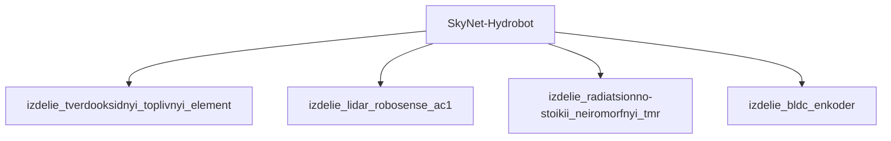

## Описание

Hydrobot — змееобразный водный терминатор; плавающий; хватательные манипуляторы-«зубы»; патрулирует реки и каналы.

## Технические характеристики

| Параметр | Значение | Единица | Источник |
|---|---|---|---|
| масса | 30.0–100.0 (номинал 60.0) | kg | canon |
| тип узла | модель_SkyNet | — | canon |
| уровень_номер | 1 | — | canon |

## Источники

- Канон: Terminator: Salvation (2009)

## Декомпозиция

## Источник канон

- **Произведение:** Terminator: Salvation (2009)
- **Тип:** фильм
- **Каноничность:** canon

## Тактико-технические характеристики

| Параметр | Значение |
|---|---|
| рабочая_глубина_м | 50 |
| масса_кг | 600 |
| производитель | Скайнет |
| класс | водный_подводный |
| категория | водный_HK |
| тип_модели | водный_подводный |

## Подсистемы (по типу)

- вычислительная
- энергетическая
- каркас
- броня
- маскировка
- сенсоры
- приводная_система
- система_связи
- навигация
- система_охлаждения
- система_питания
- система_передвижения

## Многослойная броня (§11.6)

Минимум слоёв по типу: 4 (§11.6). Макс. доля массы брони: 35%.

1. Антикор. сталь (`anticorrosive_steel`)
2. RHA (`rha_steel`)
3. UHMWPE (`uhmwpe_dyneema`)
4. Резина (`rubber`)

## Произведения, где появляется

- ✅ `work_004` — «Terminator Salvation» (2009) → [`work_004.md`](../произведения/work_004.md)
- 📚 `work_045` — «Terminator: Salvation (game)» (2009) → [`work_045.md`](../произведения/work_045.md)
