# v9.31: структурные поля §12.4.1-§12.4.X — добавлены как placeholder
# Реальные значения будут заполнены через web_search для каждой модели.
требования_выживаемости: 
  эми_защита:
          уровень: hardened
          порог_импульса_В_м:
                      min: 50000
                      target: 100000
          экранирование: faraday_cage (endoskeleton как клетка Фарадея)
          фильтры_питания: true
          оптическая_развязка: true
  термобарьер:
          рабочий_диапазон_C:
                      min: -50
                      target: 60
          предел_C:
                      min: -196
                      target: 1500
  удар:
          ускорение_g:
                      min: 50
                      target: 200
          drop_высота_m: 5
  вибрация: mil-std-810h
  пулестойкость: 'малый калибр (9mm, 5.56mm) — стоп; .50 BMG — пробивает корпус'
маскировка_инфильтратора: 
  роль_модели: infiltrator (human-cyborg)
  визуальная: 'человеческое тело (полное), но с эндоскелетом'
  human_heart: true
  human_brain: true
тактико_технические_характеристики: 
  мобильность:
          максимальная_скорость_км_ч: 30
          масса_кг: 90
  cpu: 'hybrid: human brain + cybernetic endoskeleton'
  гибрид: 'человеческий мозг + роботизированный эндоскелет (canon T:S)'
защита_от_собственной_радиации: неприменимо (без RTG); T-800 использует 2 водородных топливных элементов
кибербезопасность: 
  аппаратные_меры:
          HSM: true
          secure_boot: true
          TPM: true
          anti_tamper: zeroization
  iff: SkyNet IFF v3.1 (transponder 1090 MHz + crypto)
  шифрование: AES-256 + SkyNet proprietary
  skynet_protocol: Hive (collective consciousness) или Rogue (autonomous)
эмс_внутренняя: 
  экранирование_блока_cpu: inertial shock dampers вокруг Neural Net CPU
  фильтры_питания: кабель-силовой с фильтрами EMI
  размещение_антенн: внутри черепа (слуховые сенсоры)
компоновка_изделий: 
  cpu_расположение: 'череп (endoskull, в инерционных амортизаторах)'
  энергетика: 2 водородных топливных элемента в грудной клетке (позиция сердца)
  серводвигатели: axial drive motors + clavicular trailing links
  сенсоры: 'оптические (40,000 bit display, 15x zoom, IR), слуховые, внутренний хронометр'
трассировка_соединителей: frictionless bearings + hydraulic servo-actuated control
программное_обеспечение: 'Neural Net CPU + SkyNet OS (Hive mode по умолчанию, Rogue для автономных)'
единая_эми_стратегия: 'Standalone (T-800): прямой SkyNet link; Rogue mode: автономные единицы возвращаются для sync'
единая_герметичность: IP67 (живая ткань требует герметичности для предотвращения некроза); cryogenic storage в hybermatrix перед развёртыванием
сертификация_модели_целого: 
  тест_skyet: phase_5 (F70 metrics PASS)
  канон_верификация: 'источник_разбора=канон'
журнал_экземпляра: 
  serial_number: SkyNet-XXX-NNNN
  production_date: post-2026 (Skynet autonomous manufacturing)
  deployments: []
  kill_count: 0
  last_mission: null
утилизация_после_120_лет: 'T-800: 120 лет на 1 топливной ячейке (canon); после истощения — замена ячеек или разборка на запчасти'
экипаж_оператор: 0
промышленная_база: Skynet automated factory (Cyberdyne Systems / CRS)
alice_specs: ALICE sync protocol v9.31 (SkyNet hive-mind)
original_improved: canon
дата_создания: 2026-11-03
дата_обновления: 2026-11-03
---
# SkyNet-MarcusWright

## Описание

Marcus Wright — заключённый Cyberdyne, подписавший согласие на донорство тела; киборг с человеческим сердцем и мозгом + эндоскелет; уникальный прототип.

## Источник канон

- **Произведение:** Terminator: Salvation (2009)
- **Тип:** фильм
- **Каноничность:** canon

## Тактико-технические характеристики

| Параметр | Значение |
|---|---|
| рост_см | 185 |
| масса_кг | 140 |
| производитель | Cyberdyne Systems |
| класс | гуманоидный |
| категория | гибрид |
| тип_модели | гуманоидный |

## Подсистемы (по типу)

- вычислительная
- энергетическая
- каркас
- броня
- сенсоры
- приводная_система
- система_связи
- навигация
- система_питания
- система_передвижения

## Многослойная броня (§11.6)

Минимум слоёв по типу: 3 (§11.6). Макс. доля массы брони: 30%.

1. B₄C керамика (внешний жертвенный) (`b4c`)
2. Ti-6Al-4V (кин. слой) (`ti6al4v`)
3. UHMWPE Dyneema (арамидный подслой) (`uhmwpe_dyneema`)

## Произведения, где появляется

- ✅ `work_004` — «Terminator Salvation» (2009) → [`work_004.md`](../произведения/work_004.md)

## Источники

- Канон: Terminator: Salvation (2009)

## Декомпозиция

```mermaid
graph TD
    MarcusWright["SkyNet-MarcusWright"]
    subgraph вычислительная
    marcus_человеческий_мозг["human_brain_hybrid<br/>1.4 kg (1.6%)"]
    MarcusWright --> marcus_человеческий_мозг
    end
    subgraph каркас
    marcus_эндоскелет["cybernetic_endoskeleton<br/>50.0 kg (55.6%)"]
    MarcusWright --> marcus_эндоскелет
    end
    subgraph энергетическая
    marcus_сердце_гибрид["hybrid_heart<br/>0.5 kg (0.6%)"]
    MarcusWright --> marcus_сердце_гибрид
    marcus_топливная_ячейка["fuel_cell<br/>5.0 kg (5.6%)"]
    MarcusWright --> marcus_топливная_ячейка
    marcus_человеческое_сердц["biological_heart<br/>0.3 kg (0.3%)"]
    MarcusWright --> marcus_человеческое_сердц
    end
    subgraph приводная_система
    marcus_рука_левая["servo_arm<br/>8.0 kg (8.9%)"]
    MarcusWright --> marcus_рука_левая
    marcus_рука_правая["servo_arm<br/>8.0 kg (8.9%)"]
    MarcusWright --> marcus_рука_правая
    marcus_нога_левая["servo_leg<br/>7.0 kg (7.8%)"]
    MarcusWright --> marcus_нога_левая
    marcus_нога_правая["servo_leg<br/>7.0 kg (7.8%)"]
    MarcusWright --> marcus_нога_правая
    end
    subgraph прочее
    marcus_человеческая_кожа["human_tissue<br/>3.0 kg (3.3%)"]
    MarcusWright --> marcus_человеческая_кожа
    end
```

