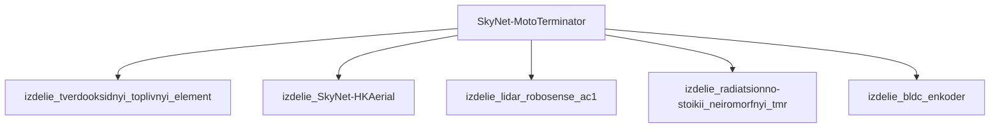

## Описание

Moto-Terminator — автономный мотоцикл; 2 колеса; высокая скорость; плазменные орудия спереди; используется в погоне за людьми.

## Технические характеристики

| Параметр | Значение | Единица | Источник |
|---|---|---|---|
| масса | 180.0–250.0 (номинал 220.0) | kg | canon |
| габариты (Д×Ш×В) | 2100×800×1100 | mm | canon |
| тип узла | модель_SkyNet | — | canon |
| уровень_номер | 1 | — | canon |

## Источники

- Канон: Terminator: Salvation (2009)

## Декомпозиция

## Источник канон

- **Произведение:** Terminator: Salvation (2009)
- **Тип:** фильм
- **Каноничность:** canon

## Тактико-технические характеристики

| Параметр | Значение |
|---|---|
| число_осей | 1 |
| масса_кг | 350 |
| производитель | Скайнет |
| класс | наземный_колёсный |
| категория | наземный_HK |
| тип_модели | наземный_колёсный |

## Подсистемы (по типу)

- вычислительная
- энергетическая
- каркас
- сенсоры
- приводная_система
- система_связи
- навигация
- система_питания
- система_передвижения

## Многослойная броня (§11.6)

Минимум слоёв по типу: 3 (§11.6). Макс. доля массы брони: 40%.

1. B₄C (`b4c`)
2. Ti-6Al-4V (`ti6al4v`)
3. UHMWPE (`uhmwpe_dyneema`)

## Произведения, где появляется

- ✅ `work_004` — «Terminator Salvation» (2009) → [`work_004.md`](../произведения/work_004.md)
- 📚 `work_045` — «Terminator: Salvation (game)» (2009) → [`work_045.md`](../произведения/work_045.md)
