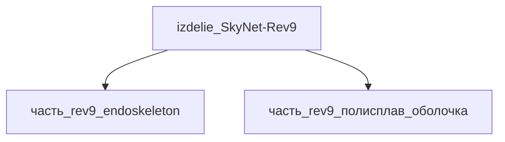

## Описание

Wrapper-изделие для модели `SkyNet-Rev9` (тип: гуманоидный, подсистема: каркас).

Создано для поддержки декомпозиции: дочерние части (часть_*) ссылаются на
этот id как на родителя. Сама модель остаётся в фантастические данные/модели/.

## Технические характеристики

| Параметр | Значение | Единица | Источник |
|---|---|---|---|
| подсистема | каркас | — | canon |
| подтип | прочее | — | canon |
| масса | 175.0 | kg | canon |
| тип узла | изделие | — | canon |
| уровень_номер | 1 | — | canon |

## Состав

Дочерние части:
- `часть_rev9_endoskeleton`
- `часть_rev9_полисплав_оболочка`

## Используемые технологии

- `autoclave_composite_curing` (доля: 1.0)
- `parylene_c` (доля: 1.0)

## Используемые материалы

- `carbon_fiber_composite` (форма: силовые_элементы_эндоскелета) → [`carbon_fiber_composite`](../../../материалы/carbon_fiber_composite.md)
- `liquid_metal_polyalloy` (форма: эластомерная_оболочка_для_инфильтрации) → [`liquid_metal_polyalloy`](../../../материалы/liquid_metal_polyalloy.md)

## Источники

- Wrapper-изделие создано автоматически (2026-11-03) для поддержки декомпозиции

## Декомпозиция

## Связанная модель

- [`SkyNet-Rev9`](../../../../фантастические%20данные/модели/rev9) — модель SkyNet
