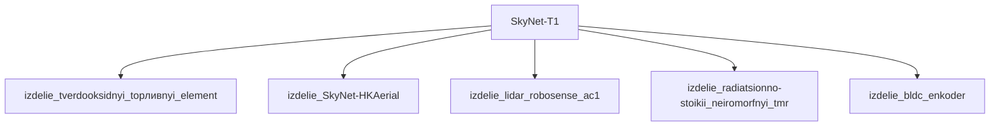

## Описание

T-1 — прототип наземного боевого дрона; гусеницы; автономный; запущен Cyberdyne до Судного дня; вооружён 2 Minigun M134.

## Технические характеристики

| Параметр | Значение | Единица | Источник |
|---|---|---|---|
| масса | 1500.0–2200.0 (номинал 2000.0) | kg | canon |
| тип узла | модель_SkyNet | — | canon |
| уровень_номер | 1 | — | canon |

## Источники

- Канон: Terminator 3: Rise of the Machines (2003)

## Декомпозиция

## Источник канон

- **Произведение:** Terminator 3: Rise of the Machines (2003)
- **Тип:** фильм
- **Каноничность:** canon

## Тактико-технические характеристики

| Параметр | Значение |
|---|---|
| длина_гусеницы_м | 2.2 |
| масса_кг | 800 |
| производитель | Cyberdyne Systems |
| класс | наземный_гусеничный |
| категория | наземный_HK |
| тип_модели | наземный_гусеничный |

## Подсистемы (по типу)

- вычислительная
- энергетическая
- каркас
- броня
- сенсоры
- приводная_система
- система_связи
- навигация
- система_питания
- система_передвижения

## Многослойная броня (§11.6)

Минимум слоёв по типу: 4 (§11.6). Макс. доля массы брони: 50%.

1. B₄C (внешний) (`b4c`)
2. RHA steel (кин.) (`rha_steel`)
3. UHMWPE (арамидный) (`uhmwpe_dyneema`)
4. Резина (подложка) (`rubber`)

## Произведения, где появляется

- ✅ `work_003` — «Terminator 3: Rise of the Machines» (2003) → [`work_003.md`](../произведения/work_003.md)
- 📚 `work_043` — «Terminator 3: Rise of the Machines» (2003) → [`work_043.md`](../произведения/work_043.md)
- 📚 `work_044` — «Terminator 3: The Redemption» (2004) → [`work_044.md`](../произведения/work_044.md)
