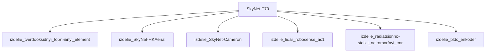

## Описание

Прототип гуманоидного терминатора Скайнет; первая бипедальная модель; рост ~2.5м, цельнометаллический эндоскелет без живой ткани.

## Технические характеристики

| Параметр | Значение | Единица | Источник |
|---|---|---|---|
| масса | 200.0–240.0 (номинал 220.0) | kg | canon |
| тип узла | модель_SkyNet | — | canon |
| уровень_номер | 1 | — | canon |

## Источники

- Канон: T2 3D: Battle Across Time (1996)

## Декомпозиция

## Источник канон

- **Произведение:** T2 3D: Battle Across Time (1996)
- **Тип:** игра
- **Каноничность:** canon

## Тактико-технические характеристики

| Параметр | Значение |
|---|---|
| рост_см | 250 |
| масса_кг | 250 |
| производитель | Скайнет |
| класс | гуманоидный |
| категория | ранняя_наземная |
| тип_модели | гуманоидный |

## Подсистемы (по типу)

- вычислительная
- энергетическая
- каркас
- броня
- сенсоры
- приводная_система
- система_связи
- навигация
- система_питания
- система_передвижения

## Многослойная броня (§11.6)

Минимум слоёв по типу: 3 (§11.6). Макс. доля массы брони: 30%.

1. B₄C керамика (внешний жертвенный) (`b4c`)
2. Ti-6Al-4V (кин. слой) (`ti6al4v`)
3. UHMWPE Dyneema (арамидный подслой) (`uhmwpe_dyneema`)

## Произведения, где появляется

- 📚 `work_050` — «T2 3D: Battle Across Time» (1996) → [`work_050.md`](../произведения/work_050.md)
