---

id: izdelie_SkyNet-T800
тип: изделие
категория: машиностроение
уровень_иерархии: верхний
уровень_номер: 1
подсистема: каркас
подтип: прочее
стандарты: []
исследовательская_группа: skynet
родитель: null
дочерние_части:
  - часть_t800_cpu
  - часть_t800_топливная_ячейка_1
  - часть_t800_эндоскелет_торс
  - часть_t800_рука_левая
  - часть_t800_нога_левая
  - часть_t800_оптический_сенсор_1
  - часть_t800_аудио_сенсор
  - часть_t800_антенна
  - часть_t800_гиро_навигация
  - часть_t800_ткань_кожа
материалы_частей:
  - часть: часть_t800_эндоскелет_торс
    материал: hyperalloy_t800
    форма: силовые_элементы_конструкций
    доля_массы: 0.357
  - часть: часть_t800_cpu
    материал: silicon_neural_net
    форма: нейроморфные_вычислительные_ядра
    доля_массы: 0.0036
  - часть: часть_t800_топливная_ячейка_1
    материал: lithium_hydrogen_cell
    форма: аккумуляторные_ячейки
    доля_массы: 0.0357
  - часть: часть_t800_рука_левая
    материал: hyperalloy_t800
    форма: силовые_элементы_конструкций
    доля_массы: 0.0857
  - часть: часть_t800_нога_левая
    материал: hyperalloy_t800
    форма: силовые_элементы_конструкций
    доля_массы: 0.1286
  - часть: часть_t800_ткань_кожа
    материал: living_tissue_clone
    форма: имитация_живых_тканей
    доля_массы: 0.129
  - часть: часть_t800_оптический_сенсор_1
    материал: si
    форма: подложки_ис_и_мэмс
    доля_массы: 0.0014
  - часть: часть_t800_аудио_сенсор
    материал: si
    форма: подложки_ис_и_мэмс
    доля_массы: 0.0007
  - часть: часть_t800_антенна
    материал: poliimid
    форма: подложка_fpc
    доля_массы: 0.0021
  - часть: часть_t800_гиро_навигация
    материал: al_6061-t6
    форма: корпуса_электроники
    доля_массы: 0.0004
технологии_частей:
  - часть: часть_t800_эндоскелет_торс
    технология: vakuumnoe_spekanie
    доля_использования: 1.0
    материалы_для_процесса:
      - материал: ti-6al-4v
        роль: обрабатываемый
  - часть: часть_t800_cpu
    технология: ion_implantation_si
    доля_использования: 1.0
    материалы_для_процесса:
      - материал: si
        роль: обрабатываемый
  - часть: часть_t800_топливная_ячейка_1
    технология: galvanika
    доля_использования: 1.0
    материалы_для_процесса:
      - материал: pt
        роль: обрабатываемый
  - часть: часть_t800_рука_левая
    технология: frezervanie_chpu
    доля_использования: 1.0
    материалы_для_процесса:
      - материал: ti-6al-4v
        роль: обрабатываемый
  - часть: часть_t800_нога_левая
    технология: frezervanie_chpu
    доля_использования: 1.0
    материалы_для_процесса:
      - материал: ti-6al-4v
        роль: обрабатываемый
  - часть: часть_t800_ткань_кожа
    технология: parylene_c
    доля_использования: 1.0
    материалы_для_процесса:
      - материал: si
        роль: обрабатываемый
  - часть: часть_t800_оптический_сенсор_1
    технология: pol-lwir
    доля_использования: 1.0
    материалы_для_процесса:
      - материал: si
        роль: обрабатываемый
  - часть: часть_t800_аудио_сенсор
    технология: bare-die_integration
    доля_использования: 1.0
    материалы_для_процесса:
      - материал: si
        роль: обрабатываемый
  - часть: часть_t800_антенна
    технология: galvanika
    доля_использования: 1.0
    материалы_для_процесса:
      - материал: poliimid
        роль: обрабатываемый
  - часть: часть_t800_гиро_навигация
    технология: anodirovanie
    доля_использования: 1.0
    материалы_для_процесса:
      - материал: al_6061-t6
        роль: обрабатываемый
наследуемые_материалы:
  - материал: ti-6al-4v
    суммарная_доля_массы: 0.5713
    источники_частей:
      - часть_t800_эндоскелет_торс
      - часть_t800_рука_левая
      - часть_t800_нога_левая
  - материал: si
    суммарная_доля_массы: 0.1347
    источники_частей:
      - часть_t800_cpu
      - часть_t800_оптический_сенсор_1
      - часть_t800_аудио_сенсор
      - часть_t800_ткань_кожа
  - материал: pt
    суммарная_доля_массы: 0.0357
    источники_частей:
      - часть_t800_топливная_ячейка_1
  - материал: poliimid
    суммарная_доля_массы: 0.0021
    источники_частей:
      - часть_t800_антенна
  - материал: al_6061-t6
    суммарная_доля_массы: 0.0004
    источники_частей:
      - часть_t800_гиро_навигация

scaling_type: количественный
масштабируемость:
  режим: фиксированная
  параметры: [масса_kg]
  пределы:
    min: {масса_kg: 100}
    max: {масса_kg: 200}
  шаг: null
  закон_масштабирования:
    масса: фиксированный (пересчёт под другой габарит = редизайн эндоскелета)
    несущая_способность: фиксированный (задана топологией hyperalloy-каркаса)
  ограничивающие_части:
    - часть: часть_t800_эндоскелет_торс
      предел: "несущая способность торса из hyperalloy (canon: 40% прочнее T-600)"
    - часть: часть_t800_топливная_ячейка_1
      предел: "энергетический бюджет ядерной ячейки (canon: 120 лет ресурса)"
    - часть: часть_t800_cpu
      предел: "вычислительный бюджет нейроморфного CPU (canon: neural net)"
соединители: []
версия: ии-улучшенная
статус_реальности: real
доступность: ии_проект
статус: извлечено
предок: izdelie_reshetchatyi_karkas
предок_путь: реальные данные/изделия/каркас/reshetchatyi_karkas/
улучшения:
  - тип: замена_материала
    что: "Алюминиевая решётка (Al 6061-T6) → hyperalloy-эндоскелет (canon); реальный аналог сплава — Tribaloy T-800 (Co-Mo-Cr-Si, Laves-фаза)"
    причина: "Удельная износостойкость Co-Mo-Cr Laves-фазы при высокой температуре многократно выше Al 6061-T6; части реального эндоскелета — Ti-6Al-4V (удельная прочность 220+ МПа·см³/г)"
    источник: "https://terminator.fandom.com/wiki/Hyperalloy; https://www.stellite.com/us/en/alloys/tribaloy/tribaloy-t800-alloy.html; powderclad.com T-800 Tribaloy powders"
    эффект_масса: "Решётчатый каркас ~50 кг (номинал) → эндоскелет 140 кг full-body (canon-габарит)"
  - тип: замена_параметра
    что: "Модульная решётка (номинал 50 кг, min 1 / max 1000) → антропометрический эндоскелет массой 140 кг"
    причина: "Канон фиксирует антропометрию инфильтратора: живая ткань поверх металлического эндоскелета, 20% легче и 40% сильнее T-600"
    источник: "https://terminator.fandom.com/wiki/T-800"
  - тип: добавление_технологии
    что: "Вакуумное спекание + ЧПУ-фрезерование Ti-6Al-4V узлов; parylene-C для кожного слоя; LWIR-матрица оптики"
    причина: "PM-маршрут для Co-Mo-Cr Laves-фазы, биосовместимое покрытие и ИК-сенсорика (canon: ИК-диапазон, x15 зум) отсутствуют в предке"
    источник: "Каталог технологии/ (vakuumnoe_spekanie, frezervanie_chpu, parylene_c, pol-lwir); terminator fandom T-800 сенсорика"
real_check:
  статус: требует_проверки
  метод: "canon-спецификации Terminator fandom (T-800, Hyperalloy); реальный аналог сплава Tribaloy T-800 верифицирован по stellite.com и powderclad.com; гиперсплав физически не существует — данные помечены как канон"
  физические_пределы_соблюдены:
    - "Масса 140 кг совместима с серийным металлическим эндоскелетом (Ti-6Al-4V / Co-Mo-Cr аналоги, оценочный вес эндоскелета ~260-450 кг у фан-источников — canon-140 кг консервативнее)"
    - "Ресурс ядерной ячейки 120 лет — canon-декларация; реальный литиево-водородный аналог ограничен 30-50 годами (электромиграция/TDDB)"
    - "Tribaloy T-800: микротвёрдость Laves-фазы ~900-1100 HV, рабочая температура до 1000°C (паспортные данные stellite.com)"
ии_перепроектирован:
  статус: true
  верификация: []
основные:
  масса_kg: 140
  максимальная_скорость_км_ч: 35
наследуемые: {}
дополнительные:
  соответствующая_модель: SkyNet-T800
  канон_источник: 'результаты/модели/t800/фантастическая реализация/_index.md'
дата_создания: 2026-11-03
дата_обновления: 2026-11-09
источник: web_search
источник_url: https://terminator.fandom.com/wiki/T-800
источник_дата: 2026-11-06
источник_разбора: канон
---

# Изделие-обёртка: SkyNet-T800

## Описание

Массо-габаритный макет инфильтратора SkyNet-T800 (canon: The Terminator, 1984) —
первый киборг SkyNet: живая ткань поверх эндоскелета из hyperalloy. По канону
сериализован в 2026 г., производитель Cyberdyne Systems; 20% легче и на 40%
сильнее T-600. Питание — ядерная энергоячейка с ресурсом 120 лет непрерывной
работы; оптика с ИК-диапазоном, x15 зумом и 40 000-битным дисплеем.

Изделие-обёртка модели `SkyNet-T800` (гуманоидный, подсистема каркас):
дочерние части (часть_*) ссылаются на этот id как на родителя, сама модель
остаётся в фантастические данные/модели/. Ключевые материалы декомпозиции:
endoskeleton — hyperalloy_t800 (доля массы 0.357), CPU — silicon_neural_net,
питание — lithium_hydrogen_cell, кожа — living_tissue_clone.

Реальный аналог конструкционного сплава chassis — Tribaloy T-800
(Co-Mo-Cr-Si, Laves-фаза, износостойкость при высокой температуре;
stellite.com/tribaloy-t800).

## Декомпозиция

```mermaid
graph TD
    T800["SkyNet-T800"]
    t800_cpu["часть_t800_cpu"]
    T800 --> t800_cpu
    t800_топливная_ячейка_1["часть_t800_топливная_ячейка_1"]
    T800 --> t800_топливная_ячейка_1
    T800 --> t800_топливная_ячейка_2
    t800_эндоскелет_торс["часть_t800_эндоскелет_торс"]
    T800 --> t800_эндоскелет_торс
    t800_рука_левая["часть_t800_рука_левая"]
    T800 --> t800_рука_левая
    T800 --> t800_рука_правая
    t800_нога_левая["часть_t800_нога_левая"]
    T800 --> t800_нога_левая
    T800 --> t800_нога_правая
    t800_оптический_сенсор_1["часть_t800_оптический_сенсор_1"]
    T800 --> t800_оптический_сенсор_1
    T800 --> t800_оптический_сенсор_2
    t800_аудио_сенсор["часть_t800_аудио_сенсор"]
    T800 --> t800_аудио_сенсор
    t800_антенна["часть_t800_антенна"]
    T800 --> t800_антенна
    t800_гиро_навигация["часть_t800_гиро_навигация"]
    T800 --> t800_гиро_навигация
    t800_ткань_кожа["часть_t800_ткань_кожа"]
    T800 --> t800_ткань_кожа
```

## Состав

Дочерние части:
- `часть_t800_cpu`
- `часть_t800_топливная_ячейка_1`
- `часть_t800_эндоскелет_торс`
- `часть_t800_рука_левая`
- `часть_t800_нога_левая`
- `часть_t800_оптический_сенсор_1`
- `часть_t800_аудио_сенсор`
- `часть_t800_антенна`
- `часть_t800_гиро_навигация`
- `часть_t800_ткань_кожа`

## Связанная модель

- [`SkyNet-T800`](../../../../фантастические%20данные/модели/t800) — модель SkyNet

## Источники

- Wrapper-изделие создано автоматически (2026-11-03) для поддержки декомпозиции
- T-800 (canon-спецификации: hyperalloy-эндоскелет, ядерная ячейка 120 лет,
  Cyberdyne Systems, сериализация 2026, сенсорика) —
  https://terminator.fandom.com/wiki/T-800 (2026-11-06)
- Hyperalloy (материал эндоскелета) — https://terminator.fandom.com/wiki/Hyperalloy
- Tribaloy T-800 — реальный аналог сплава (Co-Mo-Cr-Si, Laves-фаза) —
  https://www.stellite.com/us/en/alloys/tribaloy/tribaloy-t800-alloy.html
