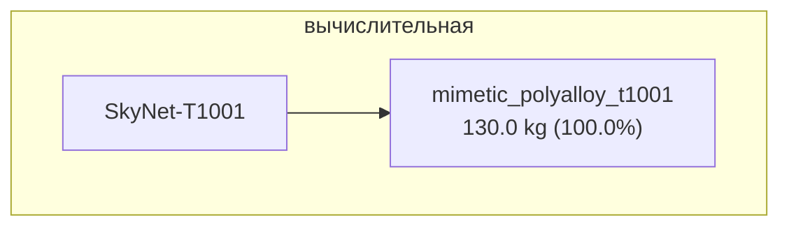

# SkyNet-T1001

## Описание

T-1001 — вариант T-1000; Catherine Weaver — CEO ZeiraCorp; перепрофилирована в защиту человека (несколько уникальных черт поведения).

## Источник канон

- **Произведение:** Terminator: The Sarah Connor Chronicles (Catherine Weaver)
- **Тип:** сериал
- **Каноничность:** canon

## Тактико-технические характеристики

| Параметр | Значение |
|---|---|
| рост_см | 175 |
| масса_кг | 110 |
| производитель | Скайнет |
| класс | гуманоидный |
| категория | жидкий_металл |
| тип_модели | жидкий_металл |

## Подсистемы (по типу)

## Многослойная броня (§11.6)

Модель типа «жидкий металл» — многослойная броня неприменима (миметический полисплав сам формирует «броню»).

## Произведения, где появляется

- ✅ `work_007` — «Terminator: The Sarah Connor Chronicles» (2008) → [`work_007.md`](../произведения/work_007.md)

## Источники

- Канон: Terminator: The Sarah Connor Chronicles (Catherine Weaver)

## Декомпозиция

