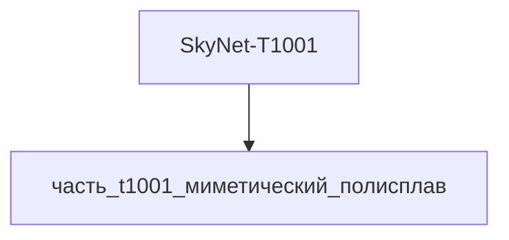

# Изделие-обёртка: SkyNet-T1001

## Описание

Wrapper-изделие для модели `SkyNet-T1001` (тип: жидкий_металл, подсистема: вычислительная).

Создано для поддержки декомпозиции: дочерние части (часть_*) ссылаются на
этот id как на родителя. Сама модель остаётся в фантастические данные/модели/.

## Декомпозиция

## Состав

Дочерние части:
- `часть_t1001_миметический_полисплав`

## Связанная модель

- [`SkyNet-T1001`](../../) — модель SkyNet

## Источники

- Wrapper-изделие создано автоматически (2026-11-03) для поддержки декомпозиции
