# SkyNet-T800

## Описание

T-800 Model 101 — каноническая модель; живая ткань поверх эндоскелета; CPU нейроморфный; источники энергии: 2 ячейки водородных топливных элементов.

## Источник канон

- **Произведение:** The Terminator (1984), T2: Judgment Day (1991), T3, T: Salvation, T: Dark Fate
- **Тип:** фильм
- **Каноничность:** canon

## Тактико-технические характеристики

| Параметр | Значение |
|---|---|
| рост_см | 185 |
| масса_кг | 140 |
| производитель | Cyberdyne Systems / Скайнет |
| класс | гуманоидный |
| категория | стандартный |
| тип_модели | гуманоидный |

## Подсистемы (по типу)

- вычислительная
- энергетическая
- каркас
- броня
- сенсоры
- приводная_система
- система_связи
- навигация
- система_питания
- система_передвижения

## Многослойная броня (§11.6)

Минимум слоёв по типу: 3 (§11.6). Макс. доля массы брони: 30%.

1. B₄C керамика (внешний жертвенный) (`b4c`)
2. Ti-6Al-4V (кин. слой) (`ti6al4v`)
3. UHMWPE Dyneema (арамидный подслой) (`uhmwpe_dyneema`)

## Произведения, где появляется

- ✅ `work_001` — «The Terminator» (1984) → [`work_001.md`](../произведения/work_001.md)
- ✅ `work_002` — «Terminator 2: Judgment Day» (1991) → [`work_002.md`](../произведения/work_002.md)
- ✅ `work_003` — «Terminator 3: Rise of the Machines» (2003) → [`work_003.md`](../произведения/work_003.md)
- ✅ `work_006` — «Terminator: Dark Fate» (2019) → [`work_006.md`](../произведения/work_006.md)
- 📚 `work_026` — «Terminator/Robocop: Kill Your Machine» (1992) → [`work_026.md`](../произведения/work_026.md)
- 📚 `work_027` — «Robocop vs. Terminator» (1993) → [`work_027.md`](../произведения/work_027.md)
- 📚 `work_037` — «The Terminator (DOS)» (1991) → [`work_037.md`](../произведения/work_037.md)
- 📚 `work_038` — «Terminator 2029» (1992) → [`work_038.md`](../произведения/work_038.md)
- 📚 `work_039` — «RoboCop versus The Terminator» (1993) → [`work_039.md`](../произведения/work_039.md)
- 📚 `work_040` — «Terminator 2: Judgment Day (arcade)» (1991) → [`work_040.md`](../произведения/work_040.md)
- 📚 `work_041` — «Terminator 2: Judgment Day - Chess Wars» (1993) → [`work_041.md`](../произведения/work_041.md)
- 📚 `work_042` — «Terminator: Dawn of Fate» (2002) → [`work_042.md`](../произведения/work_042.md)
- 📚 `work_045` — «Terminator: Salvation (game)» (2009) → [`work_045.md`](../произведения/work_045.md)
- 📚 `work_047` — «Terminator: Dark Fate — Defiance» (2023) → [`work_047.md`](../произведения/work_047.md)
- 📚 `work_048` — «Terminator: Survivors» (2025) → [`work_048.md`](../произведения/work_048.md)
- 📚 `work_049` — «Terminator Genisys: Future War» (2017) → [`work_049.md`](../произведения/work_049.md)
- 📚 `work_051` — «T2: Super Nintendo» (1993) → [`work_051.md`](../произведения/work_051.md)

## Источники

- Канон: The Terminator (1984), T2: Judgment Day (1991), T3, T: Salvation, T: Dark Fate

## Декомпозиция

```mermaid
graph TD
    T800["SkyNet-T800"]
    subgraph вычислительная
    t800_cpu["neural_net_cpu<br/>0.5 kg (0.4%)"]
    T800 --> t800_cpu
    end
    subgraph энергетическая
    t800_топливная_ячейка_1["hydrogen_fuel_cell<br/>5.0 kg (3.6%)"]
    T800 --> t800_топливная_ячейка_1
    t800_топливная_ячейка_2["hydrogen_fuel_cell<br/>5.0 kg (3.6%)"]
    T800 --> t800_топливная_ячейка_2
    end
    subgraph каркас
    t800_эндоскелет_торс["hyperalloy_endoskeleton<br/>50.0 kg (35.7%)"]
    T800 --> t800_эндоскелет_торс
    end
    subgraph приводная_система
    t800_рука_левая["servo_arm<br/>12.0 kg (8.6%)"]
    T800 --> t800_рука_левая
    t800_рука_правая["servo_arm<br/>12.0 kg (8.6%)"]
    T800 --> t800_рука_правая
    t800_нога_левая["servo_leg<br/>18.0 kg (12.9%)"]
    T800 --> t800_нога_левая
    t800_нога_правая["servo_leg<br/>18.0 kg (12.9%)"]
    T800 --> t800_нога_правая
    end
    subgraph сенсоры
    t800_оптический_сенсор_1["optical_camera<br/>0.2 kg (0.1%)"]
    T800 --> t800_оптический_сенсор_1
    t800_оптический_сенсор_2["optical_camera<br/>0.2 kg (0.1%)"]
    T800 --> t800_оптический_сенсор_2
    t800_аудио_сенсор["audio_microphone<br/>0.1 kg (0.1%)"]
    T800 --> t800_аудио_сенсор
    end
    subgraph система_связи
    t800_антенна["skyet_link_antenna<br/>0.3 kg (0.2%)"]
    T800 --> t800_антенна
    end
    subgraph навигация
    t800_гиро_навигация["imu_gyro<br/>0.5 kg (0.4%)"]
    T800 --> t800_гиро_навигация
    end
    subgraph прочее
    t800_ткань_кожа["living_tissue<br/>18.0 kg (12.9%)"]
    T800 --> t800_ткань_кожа
    end
```

