# SkyNet-T850

## Описание

T-850 — модернизация T-800; увеличены прочность и срок службы; 2 водородные ячейки питания; перепрофилированный в телохранителя Джона Коннора.

## Источник канон

- **Произведение:** Terminator 3: Rise of the Machines (2003)
- **Тип:** фильм
- **Каноничность:** canon

## Тактико-технические характеристики

| Параметр | Значение |
|---|---|
| рост_см | 185 |
| масса_кг | 150 |
| производитель | Скайнет |
| класс | гуманоидный |
| категория | стандартный |
| тип_модели | гуманоидный |

## Подсистемы (по типу)

- вычислительная
- энергетическая
- каркас
- броня
- сенсоры
- приводная_система
- система_связи
- навигация
- система_питания
- система_передвижения

## Многослойная броня (§11.6)

Минимум слоёв по типу: 3 (§11.6). Макс. доля массы брони: 30%.

1. B₄C керамика (внешний жертвенный) (`b4c`)
2. Ti-6Al-4V (кин. слой) (`ti6al4v`)
3. UHMWPE Dyneema (арамидный подслой) (`uhmwpe_dyneema`)

## Произведения, где появляется

- ✅ `work_003` — «Terminator 3: Rise of the Machines» (2003) → [`work_003.md`](../произведения/work_003.md)
- 📚 `work_043` — «Terminator 3: Rise of the Machines» (2003) → [`work_043.md`](../произведения/work_043.md)
- 📚 `work_044` — «Terminator 3: The Redemption» (2004) → [`work_044.md`](../произведения/work_044.md)

## Источники

- Канон: Terminator 3: Rise of the Machines (2003)

## Декомпозиция

```mermaid
graph TD
    T850["SkyNet-T850"]
    subgraph вычислительная
    t850_cpu["neural_net_cpu_v2<br/>0.5 kg (0.3%)"]
    T850 --> t850_cpu
    end
    subgraph энергетическая
    t850_топливная_ячейка_1["hydrogen_fuel_cell_v2<br/>6.0 kg (3.4%)"]
    T850 --> t850_топливная_ячейка_1
    t850_топливная_ячейка_2["hydrogen_fuel_cell_v2<br/>6.0 kg (3.4%)"]
    T850 --> t850_топливная_ячейка_2
    end
    subgraph каркас
    t850_эндоскелет["hyperalloy_endoskeleton<br/>60.0 kg (34.3%)"]
    T850 --> t850_эндоскелет
    end
    subgraph приводная_система
    t850_рука_левая["servo_arm_improved<br/>13.0 kg (7.4%)"]
    T850 --> t850_рука_левая
    t850_рука_правая["servo_arm_improved<br/>13.0 kg (7.4%)"]
    T850 --> t850_рука_правая
    t850_нога_левая["servo_leg_improved<br/>19.0 kg (10.9%)"]
    T850 --> t850_нога_левая
    t850_нога_правая["servo_leg_improved<br/>19.0 kg (10.9%)"]
    T850 --> t850_нога_правая
    end
    subgraph сенсоры
    t850_сенсоры["optical_audio_array<br/>1.0 kg (0.6%)"]
    T850 --> t850_сенсоры
    end
    subgraph система_связи
    t850_связь["skyet_link<br/>0.5 kg (0.3%)"]
    T850 --> t850_связь
    end
    subgraph навигация
    t850_навигация["imu_gyro<br/>0.5 kg (0.3%)"]
    T850 --> t850_навигация
    end
    subgraph прочее
    t850_ткань_кожа["living_tissue<br/>36.0 kg (20.6%)"]
    T850 --> t850_ткань_кожа
    end
```

