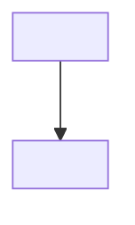

<!--
  ШАБЛОН КАРТОЧКИ ИЗДЕЛИЯ — схема §12.1 (+ §12.6 масштабируемость, §12.7 ии-поля)
  Разместить:
    верхний уровень: реальные данные/изделия/<подсистема>/<имя>/_index.md
    часть (уровни 2-4): реальные данные/изделия/<подсистема>/<имя>/<часть>.md
  Дочерние части наследуют подсистему и подтип от родителя.
  Декомпозиция обязательна (v9.28): верхнее изделие → неделимые части (≤ уровня 4).
  Замените все <...>; значения null допустимы (обоснованный «нет данных»).
-->
---
id: izdelie_<имя>                        # → уникальный (пример: izdelie_termomoduli_pelte); часть: часть_<родитель>_<имя>
тип: изделие                             # → фиксировано
категория: <машиностроение|электроника|оптика|энергетика|прочее>    # → enum
уровень_иерархии: верхний                # верхний | промежуточный | неделимый
уровень_номер: 1                         # 1 | 2 | 3 | 4
подсистема: <вычислительная|энергетическая|каркас|броня|маскировка|встроенное_оружие|сенсоры|приводная_система|система_связи|навигация|система_охлаждения|система_питания|система_передвижения|прочее>   # → ОБЯЗАТЕЛЬНО для ВСЕХ изделий (вкл. уровень 1); = имя папки-классификатора
подтип: <один из 146 подтипов §11.4|прочее>    # → ОБЯЗАТЕЛЬНО (F8 = 1.0); подтип = принцип, не параметр (P020)
стандарты: [<id_стандарта>]              # (опц., F6) ссылки на реальные данные/стандарты/
исследовательская_группа: <id_группы>     # (опц. для изделий; обязательно для материалов)
родитель: null                            # null для верхнего уровня; id родителя для частей
дочерние_части: [<часть_1>, <часть_2>]    # → для верхнего/промежуточного уровней
количество: 1                             # → ОБЯЗАТЕЛЬНО (F26 = 1.0); N идентичных копий; масса/габариты — за ОДИН экземпляр
материалы_частей:                         # → B-BOM: материал каждой части
  - часть: <id_части>
    материал: <id_материала>               # ссылка на реальные данные/материалы/
    форма: <форма_применения>             # пример: модуль_пельтье, несущая_плата_PCB
    доля_массы: 0.0                       # 0-1; сумма долей частей ≈ 1.0
наследуемые_материалы:                    # агрегация (F29 B-BOM): материал → части → суммарная доля
  - материал: <id_материала>
    форма: <форма>
    суммарная_доля_массы: 0.0
    источники_частей: [<id_части>]
технологии_частей:                        # F27e: технология обработки каждой части
  - часть: <id_части>
    технология: <id_технологии>            # ссылка на реальные данные/технологии/
    доля_использования: 1.0
    материалы_для_процесса:
      - материал: <id_материала>
        роль: обрабатываемый
масштабируемость:                          # §12.6 (опц., v9.32) — физическая пересчитываемость
  режим: масштабируемая                   # масштабируемая | квантуемая | фиксированная
  параметры: [<масса_kg>, <мощность_W>]   # что масштабируется
  пределы:
    min: {<параметр>: 0}
    max: {<параметр>: 0}
  шаг: null                               # null=непрерывно; [5,8,10]=ряд; число=дискрет
  закон_масштабирования:
    масса: линейный                        # линейный | квадратичный | кубический | кусочно
  ограничивающие_части:                   # какие дети ограничивают родителя
    - часть: <id_части>
      причина: '<порт/размер/техпроцесс>'
scaling_type: количественный               # количественный | качественный (P040: N идентичных копий)
соединители: [<кабель_силовой|шланг_гидравлический|шина_данных|разъём>]
версия: реальная                          # реальная | ии-улучшенная (для работа и и/)
статус_реальности: real                  # в реальные данные/ — ТОЛЬКО real
доступность: <фантастический|теоретический|лабораторный|ограниченный|промышленный|ии_проект|устаревший>   # §32 TRL
статус: извлечено                         # извлечено | верифицировано | оптимизировано
ии_перепроектирован:                      # §12.0
  статус: false
  верификация: []
основные:                                 # → физическое воплощение
  масса_kg: {min: null, max: null, nominal: null}
  габариты_mm: {l: null, w: null, h: null}
  выработка_энергии_W: {min: null, max: null, nominal: null}
  выработка_тепла_W: {min: null, max: null, nominal: null}
наследуемые:                               # вычисляемые агрегаты (computed_from дочерних)
  масса_kg: {computed_from: 'SUM(дочерних.масса_kg × доля_массы)'}
  прочность_МПа: {computed_from: 'MIN(дочерних.прочность_МПа)'}       # weakest link
  энергопотребление_W: {computed_from: 'SUM(дочерних.пиковое_потребление_W)'}
  тепловыделение_W: {computed_from: 'SUM(дочерних.выработка_тепла_W)'}
  стоимость_usd: {computed_from: 'SUM(дочерних.стоимость_usd)'}
  lifetime_years: {computed_from: 'MIN(дочерних)'}
дополнительные:
  цена_usd: null
  форм_фактор: '<описание>'              # пример: M.2-модуль 2280
  обоснование_габаритов: '<расчёт габаритов/объёма, V ≥ ΣV(детей)×1.15 (F15g)>'
дата_создания: ГГГГ-ММ-ДД                # §12.0
дата_обновления: ГГГГ-ММ-ДД              # §12.0
источник: <user_input|web_search|вывод_ИИ>
источник_url: '<URL если web_search>'
источник_разбора: <канон|веб-поиск|вывод_ИИ|пользовательский ввод + веб-поиск>   # §12.0
---
# Изделие: <название>

## Описание

<Назначение, принцип действия, ключевые характеристики. Для части — роль в составе родителя.>

Полное наименование (как в CSV): `<имя>`

## Технические характеристики

| Параметр | Значение | Единица | Источник |
|---|---|---|---|
| подсистема | <...> | — | classify_subsystem |
| категория | <...> | — | — |
| тип узла | изделие | — | canon |

## Состав

<Для верхнего уровня — перечень составных частей:>

- `<id_части_1>` — <что это, сколько штук>;
- `<id_части_2>` — <...>.

## Декомпозиция

## Используемые технологии

- <Технология 1> → [технологии/<id>.md](../../../технологии/<id>.md)

## Используемые материалы

- <Материал 1> → [материалы/<id>.md](../../../материалы/<id>.md)

## Принцип работы

<Физический принцип, режимы, ограничения.>

## Варианты реализации

<Только для верхнего уровня: варианты исполнения.>

## Сравнение с реальным аналогом

<Только для ИИ-улучшенных вариантов (версия: ии-улучшенная): что улучшено, эффект.>

## Источники

- <Источник 1> — <что подтвердил>: <URL> (проверено ГГГГ-ММ-ДД)

<!--
  ═════════ ДОПОЛНЕНИЕ для версия: ии-улучшенная (§12.7, работа и и/) ═════════
  предок: <id_real_компонента>
  предок_путь: реальные данные/изделия/<подсистема>/<имя>/
  улучшения:                            # ≥1 запись
    - тип: <замена_материала|замена_технологии|добавление_технологии|оптимизация_геометрии|замена_параметра>
      что: '<что изменено>'
      причина: '<физическое обоснование>'
      источник: '<откуда>'
      эффект_масса: '<...>'              # (опц.)
  real_check:                            # ОБЯЗАТЕЛЬНО
    статус: <проверен|требует_проверки|отклонён>
    метод: '<итерации/источники>'
  Имя файла: <оригинал>__ии.md
  ══════════════════════════════════════════════
-->

## Чек-лист перед коммитом

- [ ] подсистема и подтип заполнены (F8); совпадают с папкой-классификатором.
- [ ] Декомпозиция выполнена: верхнее изделие → части (v9.28), родитель/дочерние согласованы.
- [ ] количество ≥ 1 (F26); доля_массы частей в сумме ≈ 1.0.
- [ ] материалы_частей / технологии_частей ссылаются на существующие карточки.
- [ ] V ≥ ΣV(детей) × 1.15 — габариты обоснованы (F15g).
- [ ] Для ии-улучшенной: предок + улучшения + real_check (§12.7).
