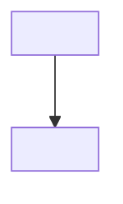

<!--
  ШАБЛОН КАРТОЧКИ ИЗДЕЛИЯ — схема §12.1 (+ §12.6 масштабируемость, §12.7 ии-поля)
  Разместить:
    верхний уровень: реальные данные/изделия/<подсистема>/<имя>/_index.md
    часть (уровни 2-4): реальные данные/изделия/<подсистема>/<имя>/<часть>.md
  Дочерние части наследуют подсистему и подтип от родителя.
  Декомпозиция обязательна (v9.28): верхнее изделие → неделимые части (≤ уровня 4).
  Замените все <...>; значения null допустимы (обоснованный «нет данных»).
  Числовые поля основные — одиночные значения (конструкция {min, max, nominal} не используется, v6).
  оптимальная_структура материала — вложенное поле материалы_частей (F62): выбор
  структуры определяется применением (частью), а не самим материалом (P062).

  СТРУКТУРА ФАЙЛА (обязательные правила рендера на GitHub):
  • строка 1 файла — «---»: только тогда GitHub распознаёт YAML front matter
    и выводит его отдельной таблицей вверху страницы; если перед «---» есть
    любой другой текст (например, этот комментарий) — блок «сливается» с телом;
  • внутри Markdown-тела разделитель «---» не используется — разделы
    разделяются только заголовками «##»;
  • каждое числовое/enum-значение вносится ОДИН раз — в front matter;
    тело карточки значения не повторяет (правило «одно значение — одно место», F26).
-->
# Изделие: <название>

> **Единый источник данных.** Все числовые и enum-значения изделия — в YAML front matter вверху файла (поля `основные`, `дополнительные`, `материалы_частей` (включая вложенную `оптимальная_структура`, F62), `технологии_частей`, `дочерние_части`, `масштабируемость`); GitHub отрендерит front matter таблицей в начале страницы. Тело карточки — повествование, ссылки и mermaid-граф; повторять значения из front matter запрещено (правило «одно значение — одно место», F26).

## Описание

<Назначение, принцип действия, ключевые характеристики. Для части — роль в составе родителя.>

Полное наименование (как в CSV): `<имя>`

## Состав

<Для верхнего уровня — аннотированный перечень составных частей. Список — наглядное пояснение к полям `дочерние_части` / `материалы_частей` / `технологии_частей` front matter; идентификаторы и доли из front matter не дублируются — здесь только роль и назначение:>

- `<id_части_1>` — <что это, какую роль выполняет>;
- `<id_части_2>` — <...>.

## Декомпозиция

## Используемые технологии

<Список должен соответствовать полю `технологии_частей` front matter:>

- <Технология 1> → [технологии/<id>.md](../../../технологии/<id>.md)

## Используемые материалы

<Список должен соответствовать полям `материалы_частей` / `наследуемые_материалы` (B-BOM) front matter; для каждого материала в `материалы_частей.оптимальная_структура` зафиксирован выбор структурного варианта (F62/P062) — обоснование выбора в теле не дублируется:>

- <Материал 1> → [материалы/<id>.md](../../../материалы/<id>.md)

## Принцип работы

<Физический принцип, режимы, ограничения.>

## Варианты реализации

<Только для верхнего уровня: варианты исполнения.>

## Сравнение с реальным аналогом

<Только для ИИ-улучшенных вариантов (версия: ии-улучшенная): что улучшено, эффект.>

## Источники

<Первичный источник — поля `источник` / `источник_url` / `источник_разбора` front matter. Здесь перечисляются дополнительные источники и что каждый из них подтвердил:>

- <Источник 1> — <что подтвердил>: <URL> (проверено ГГГГ-ММ-ДД)

<!--
  ═════════ ДОПОЛНЕНИЕ для версия: ии-улучшенная (§12.7, работа и и/) ═════════
  предок: <id_real_компонента>
  предок_путь: реальные данные/изделия/<подсистема>/<имя>/
  улучшения:                            # ≥1 запись
    - тип: <замена_материала|замена_технологии|добавление_технологии|оптимизация_геометрии|замена_параметра>
      что: '<что изменено>'
      причина: '<физическое обоснование>'
      источник: '<откуда>'
      эффект_масса: '<...>'              # (опц.)
  real_check:                            # ОБЯЗАТЕЛЬНО
    статус: <проверен|требует_проверки|отклонён>
    метод: '<итерации/источники>'
  Имя файла: <оригинал>__ии.md
  ══════════════════════════════════════════════
-->

## Чек-лист перед коммитом

- [ ] подсистема и подтип заполнены (F8); совпадают с папкой-классификатором.
- [ ] Декомпозиция выполнена: верхнее изделие → части (v9.28), родитель/дочерние согласованы.
- [ ] количество ≥ 1 (F26); доля_массы частей в сумме ≈ 1.0.
- [ ] Данные не дублируются: все числа — только в front matter; тело — повествование, ссылки и mermaid-граф.
- [ ] масса_kg / выработка_энергии_W / выработка_тепла_W — одиночные значения (не {min, max, nominal}).
- [ ] материалы_частей / технологии_частей ссылаются на существующие карточки.
- [ ] оптимальная_структура заполнена для каждого материала_частей (F62); значение — из enum «вариант» кристаллической_структуры карточки материала (14 значений, вкл. микрокристаллический, молекулярный_кристалл).
- [ ] V ≥ ΣV(детей) × 1.15 — габариты обоснованы (F15g).
- [ ] Для ии-улучшенной: предок + улучшения + real_check (§12.7).
