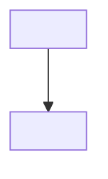

---
# ═══════════ ШАБЛОН КАРТОЧКИ ИЗДЕЛИЯ — v11.0 (схема §12.1 + §12.6, §12.7) ═══════════
# Правила: строка 1 — «---»; тело без «---» (только заголовки ##); значения — один раз в front matter (F26).
# Разместить: верхний уровень — реальные данные/изделия/<подсистема>/<имя>/_index.md;
# часть (уровни 2–4) — реальные данные/изделия/<подсистема>/<имя>/<часть>.md
# Дочерние части наследуют подсистему и подтип от родителя. Декомпозиция обязательна (v9.28).

# ── Метаданные (единый блок для всех карточек системы) ──
метаданные:
  версия_схемы: 11.0
  версия: реальная                     # реальная | ии-улучшенная
  статус_реальности: real              # в реальные данные/ — только real
  доступность: <фантастический|теоретический|лабораторный|ограниченный|промышленный|ии_проект|устаревший>   # §32 TRL
  статус: извлечено                    # извлечено | верифицировано | оптимизировано
  ии_перепроектирован: нет             # нет | да; при «да» — блок §12.7 в конце файла
  источник:
    тип: user_input                    # user_input | web_search | вывод_ИИ | пользовательский_ввод + веб-поиск (§12.0)
    url: '<URL, если web_search>'
    дата: ГГГГ-ММ-ДД
  создано: ГГГГ-ММ-ДД
  обновлено: ГГГГ-ММ-ДД

# ── Классификация и иерархия ──
id: izdelie_<имя>                      # пример: izdelie_termomoduli_pelte; часть: часть_<родитель>_<имя>
тип: изделие                           # фиксировано
категория: <машиностроение|электроника|оптика|энергетика|прочее>   # enum
уровень_иерархии: верхний              # верхний | промежуточный | неделимый
уровень_номер: 1                       # 1 | 2 | 3 | 4
подсистема: <одна из 13 подсистем §11.0>   # обязательно для ВСЕХ изделий; = имя папки-классификатора
подтип: <один из 146 подтипов §11.4|прочее>   # обязательно (F8); подтип = принцип, не параметр (P020)
стандарты: [<id_стандарта>]            # опц. (F6) — реальные данные/стандарты/
исследовательская_группа: <id_группы>  # опц. для изделий; обязательно для материалов
родитель: null                         # null для верхнего уровня; id родителя для частей
дочерние_части: [<часть_1>, <часть_2>] # для верхнего/промежуточного уровней
количество: 1                          # обязательно (F26); N идентичных копий; масса/габариты — за один экземпляр

# ── B-BOM: материалы и технологии частей ──
материалы_частей:
  - часть: <id_части>
    материал: <id_материала>           # ссылка на реальные данные/материалы/
    форма: <форма_применения>          # пример: модуль_пельтье, несущая_плата_PCB
    доля_массы: 0.0                    # 0–1; сумма долей частей ≈ 1.0
    оптимальная_структура:             # обязательно (F62 ≥ 0.90, P062): выбор определяет применение
      вариант_id: <id_варианта>        # ← ссылка на структурные_варианты.id карточки материала (v10.1); машиночитаемая связь вместо свободного enum
      обоснование_выбора: '<физика применения в этой части: циклическая нагрузка → поли-; крип > 700 °C → моно-; ВЧ-магнитопровод → аморфный; UD-укладка → композиционный>'
      источник_обоснования: <web_search|kb_lookup|computed_from_physics>
наследуемые_материалы:                 # агрегация (F29): материал → части → суммарная доля; оптимальная_структура не дублируется
  - материал: <id_материала>
    форма: <форма>
    суммарная_доля_массы: 0.0
    источники_частей: [<id_части>]
технологии_частей:                     # F27e: технология обработки каждой части
  - часть: <id_части>
    технология: <id_технологии>        # ссылка на реальные данные/технологии/
    доля_использования: 1.0
    материалы_для_процесса:
      - материал: <id_материала>
        роль: обрабатываемый

# ── Масштабируемость (§12.6, опц., v9.32) — физическая пересчитываемость ──
масштабируемость:
  режим: масштабируемая                # масштабируемая | квантуемая | фиксированная
  параметры: [<масса_kg>, <мощность_W>]
  пределы:
    min: {<параметр>: 0}
    max: {<параметр>: 0}
  шаг: null                            # null = непрерывно; [5, 8, 10] = ряд; число = дискрет
  закон_масштабирования:
    масса: линейный                    # линейный | квадратичный | кубический | кусочно
  ограничивающие_части:
    - часть: <id_части>
      причина: '<порт/размер/техпроцесс>'
scaling_type: количественный           # количественный | качественный (P040)
соединители: [<кабель_силовой|шланг_гидравлический|шина_данных|разъём>]

# ── Физическое воплощение: каждое — одно значение (v6) ──
основные:
  масса_kg: null                       # масса конкретного изделия
  габариты_mm: {l: null, w: null, h: null}
  выработка_энергии_W: null
  выработка_тепла_W: null
наследуемые:                           # вычисляемые агрегаты (computed_from дочерних)
  масса_kg: {computed_from: 'SUM(дочерних.масса_kg × доля_массы)'}
  прочность_МПа: {computed_from: 'MIN(дочерних.прочность_МПа)'}   # weakest link
  энергопотребление_W: {computed_from: 'SUM(дочерних.пиковое_потребление_W)'}
  тепловыделение_W: {computed_from: 'SUM(дочерних.выработка_тепла_W)'}
  стоимость_usd: {computed_from: 'SUM(дочерних.стоимость_usd)'}
  lifetime_years: {computed_from: 'MIN(дочерних)'}
дополнительные:
  цена_usd: null
  форм_фактор: '<описание>'            # пример: M.2-модуль 2280
  обоснование_габаритов: '<V ≥ ΣV(деталей) × 1.15 (F15g)>'
---

# Изделие: <название>

> **Единый источник данных.** Все числовые и enum-значения — в YAML front matter (поля `основные`, `дополнительные`, `материалы_частей` с вложенной `оптимальная_структура`, `технологии_частей`, `дочерние_части`, `масштабируемость`). Тело — повествование, ссылки и mermaid-граф; повторять значения запрещено (F26).

## Описание

<Назначение, принцип действия, ключевые характеристики. Для части — роль в составе родителя.>

Полное наименование (как в CSV): `<имя>`

## Состав

<Аннотированный перечень составных частей; идентификаторы и доли не дублируются — только роль и назначение:>

- `<id_части_1>` — <что это, какую роль выполняет>;
- `<id_части_2>` — <...>.

## Декомпозиция

## Используемые технологии

<Соответствует полю `технологии_частей`:>

- <Технология 1> → [технологии/<id>.md](../../../технологии/<id>.md)

## Используемые материалы

<Соответствует полям `материалы_частей` / `наследуемые_материалы`; выбор структурного варианта для каждой части зафиксирован в `оптимальная_структура.вариант_id` и в теле не дублируется:>

- <Материал 1> → [материалы/<id>.md](../../../материалы/<id>.md)

## Принцип работы

<Физический принцип, режимы, ограничения.>

## Варианты реализации

<Только для верхнего уровня.>

## Сравнение с реальным аналогом

<Только для версии: ии-улучшенная.>

## Источники

<Первичный источник — `метаданные.источник`. Дополнительные источники:>

- <Источник 1> — <что подтвердил>: <URL> (проверено ГГГГ-ММ-ДД)

<!--
  ═══ БЛОК для версия: ии-улучшенная (§12.7, работа и и/) — добавлять при необходимости ═══
  предок: <id реального компонента>
  предок_путь: реальные данные/изделия/<подсистема>/<имя>/
  улучшения:
    - тип: <замена_материала|замена_технологии|добавление_технологии|оптимизация_геометрии|замена_параметра>
      что: '<что изменено>'
      причина: '<физическое обоснование>'
      источник: '<откуда>'
      эффект_масса: '<...>'   # опц.
  real_check:
    статус: <проверен|требует_проверки|отклонён>
    метод: '<итерации/источники>'
  Имя файла: <оригинал>__ии.md
-->

## Чек-лист (только неавтоматизируемое; остальное — CI по схеме и инвариантам)

- [ ] подсистема и подтип заполнены (F8); совпадают с папкой-классификатором.
- [ ] Декомпозиция согласована: родитель ↔ дочерние_части.
- [ ] оптимальная_структура.вариант_id для каждой части ссылается на существующий вариант в карточке материала (F62).
- [ ] материалы_частей / технологии_частей ссылаются на существующие карточки.
- [ ] Габариты обоснованы: V ≥ ΣV(детей) × 1.15 (F15g).
- [ ] Для ии-улучшенной: предок + улучшения + real_check (§12.7).
